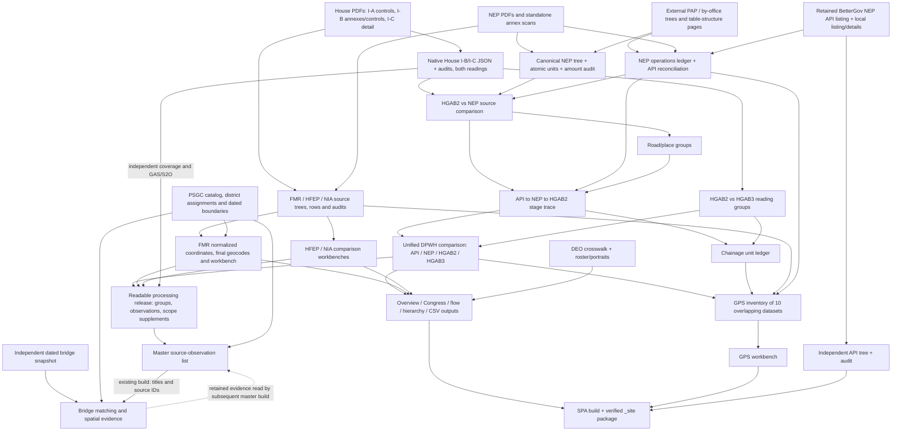
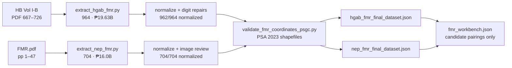

# Data provenance map — from source PDFs to analysis datasets

Updated: **26 October 2026**.

This document maps the active FY2027 dataset families and their supporting
reference, geographic, and review layers back to PDF pages, API snapshots,
reference catalogs, and review decisions. Historical collections and external
inputs are identified separately; rendered images and copied release files
are grouped with their producing datasets rather than treated as new ledgers.
It is the suite-wide
companion to the DPWH-specific [data pipeline](data_pipeline.md), the
[data user guide](data_user_guide.md), and the per-dataset catalogs in the
`#sources` workspace and [shareable datasets by page](shareable_datasets_by_page.md).

Provenance in this repository is **not centralized**. There is no single
master audit. Pipelines use their own `metadata`, `manifest`, `provenance`,
and `*_audit.json` records, with different coverage of source paths, hashes,
page ranges, code versions, and review decisions. Some historical artifacts
have no current generator. This map connects those records to actual builder
reads and writes.
A recorded hash is a provenance claim; it is checked separately against the
current file bytes. See [audit results](#11-verification-results-and-open-gaps)
for the scope and limitations of this review.

**Scope note.** `master_list/data/audit.json` is the input ledger of *one
consumer* (the master-list collation). The fuller provenance record is
distributed across the artifacts indexed in §7 of this document.

Quick navigation: [source PDFs](#1-layer-0--retained-sources) ·
[extraction](#2-layer-1--extraction-ledgers) ·
[cleaned-title fields](#31-which-fields-are-actually-cleaned) ·
[comparisons and master list](#4-layer-3--joins-comparisons-collation) ·
[diagrams](#6-end-to-end-lineage-diagrams) ·
[artifact index](#7-dataset-index-principal-artifacts) ·
[verification findings](#11-verification-results-and-open-gaps) ·
[recommended reuse](#12-which-datasets-to-reuse-for-a-simpler-processing-list).

---

## 0. How provenance is recorded (conventions)

| Mechanism | Where | What it pins |
|---|---|---|
| `metadata` block | annex trees (`*_tree.json`, `*_dataset.json`) | source PDF path + SHA-256, PDF/printed page ranges, cross-volume controls, extractor SHA-256, PyMuPDF/OpenCV versions, legislative-stage caveat |
| `provenance` block | `nep_2027_tree.json`, `nep_2027_budget_units.json`, `hb_dpwh_leaves_corrected_v5.json` | input file paths (including the external OCR tree), SHA-256 per input, source PDF page map |
| `manifest` block | `comparison_manifest.json`, `group_relations_*`, workbench payloads | generator path + SHA-256, generator dependency hashes, every input dataset's SHA-256, build timestamp |
| `*_audit.json` | every extraction (`hgab_fmr_audit.json`, `nep_2027_source_audit.json`, …) | control reconciliations, rollup checks, repair ledgers, printed-defect exceptions |
| `input_files` / `output_sha256` | `master_list/data/audit.json` | Validated processing release/direct provenance plus reference/control inputs, and 3 compressed outputs; builder hashes are separate; viewer products have their own manifest |
| `source_verification_manifest.json` | `analysis/data/` | 3,209 input hashes, including 3,192 active evidence image paths; the directory also contains older unreferenced images |
| `viewer_manifest.json` | `master_list/data/`, `bridge_inventory/data/` | viewer build inputs/outputs |
| Deterministic gzip | `master_list/data/*.csv.gz`, bridge exports | fixed gzip timestamps; byte-identical rebuilds from identical inputs |

Two standing policies travel with these records:

- `comparison_ready: false` in the comparison and source-verification
  manifests — balanced arithmetic does not certify project identity.
- IDs (`ib:p667:r2`, `nep_fmr:p1:r3`, `hb:ic:c18561`, …) are **source
  locators** (document + page + row), never certified cross-document identity.

---

## 1. Layer 0 — retained sources

### 1.1 House General Appropriations Bill, HB 10858 (FY 2027)

Two copies are retained: a **supplied working copy** (`HB_BUDGET/`) and a
**named third-reading copy** (`HB_BUDGET_3rd_reading/`). The working copy's
legislative reading is **not independently authenticated**; 123 annex pages
(60 FMR + 17 HFEP + 46 NIA) were verified textually identical between the two
copies ([verification](hgab_reading_comparison.md)). The annex extractors
retain this reading-comparison evidence. It does not authenticate the stage of the entire working copy.

| File | SHA-256 (prefix) | Role |
|---|---|---|
| `HB_BUDGET/1 - HB 10858 VOL IA.pdf` | `6fffb251…` | I-A (1,339 pp): agency appropriations, special provisions, allocation tables; split part-1 (866 pp)/part-2 (473 pp) copies retained |
| `HB_BUDGET/2 - HB 10858 VOL IB.pdf` | `a82800c4…` | **I-B (982 pp): the annex volume** — FMR pp 667–726, HFEP 877–893, NIA 896–941, NIA agency 567–572; DPWH I-B controls pp 9, 13–110 |
| `HB_BUDGET/3 - HB 10858 VOL IC.pdf` | `0b790d60…` | **I-C (942 pp): DPWH project details**, pp 9–942, native text layer |
| `HB_BUDGET/4 - HB 10858 VOL II.pdf` | `6303bbd6…` | Vol II (610 pp): performance indicators, not appropriation line items; note its text carries "3RD READING" imprints despite the folder — placement alone does not establish version |
| `HB_BUDGET_3rd_reading/1-…VOL I-A.pdf` … `4-HB 10858 3RD READING VOL II.pdf` | `79f56b8d…`, `4cc0f17e…`, `48cb7a11…`, `376ddaf7…` | Third-reading copies (same page counts: 1,339/982/942/610) for the reading-change comparison; the I-C filename has a space before `.pdf` |

PaddleOCR-VL 1.6 JSON/Markdown sidecars sit beside each working-copy volume;
they support orientation checks and cross-reads but are **not** the extraction
path for House data (all House extracts are native-text).

### 1.2 DBM National Expenditure Program FY 2027

| File | SHA-256 (prefix) | Role |
|---|---|---|
| `dbm-nep-data/NEP-2027-VOLUME-1_OCR.pdf` | `566ad397…` | Volume I (1,614 pp): FMR cross-volume controls, PDF pp 169–170 |
| `dbm-nep-data/NEP-2027-VOLUME-2A_OCR.pdf` | `3ec3cfb8…` | Volume II-A (772 pp): HFEP agency control, PDF p 282 (printed 274); HFEP annex occupies PDF pp 727–739 |
| `dbm-nep-data/NEP-2027-VOLUME-2B_OCR.pdf` | `bfc8282d…` | **Volume II-B (722 pp): canonical DPWH NEP detail** (root p 8; PS pp 13–28; PAP pp 115–690) |
| `dbm-nep-data/NEP-2027-VOLUME-3_OCR.pdf` | `4e9bfde9…` | Volume III (1,096 pp): retained reference (recompressed under GitHub's 100 MB limit; page counts and spot-checks match) |

### 1.3 Standalone NEP annex prints (scanned) + OCR sidecars

| File | SHA-256 (prefix) | Extracted by | Notes |
|---|---|---|---|
| `dbm-other-nep-line-data/FMR.pdf` | `07355c11…` | `extract_nep_fmr.py` | 47 pp, embedded OCR; printed 1511–1557; full-volume equivalent pp 1535–1581 |
| `dbm-other-nep-line-data/HFEP_2.pdf` | `da273672…` | `extract_nep_hfep.py` (via OCR JSON) | 13 pp; = Volume II-A PDF 727–739 (printed 719–731); page offset +726 |
| `dbm-other-nep-line-data/NIA.pdf` | `eadad324…` | `extract_nep_nia.py` | 30 pp, CCITT scans with embedded OCR |
| `HFEP.pdf_by_PP-StructrueV3.json` | `ba57cd3b…` | — | **Primary OCR source** for NEP HFEP (PP-StructureV3 tokens); sidecars keep the `HFEP.pdf_*` name although the retained PDF is `HFEP_2.pdf` (same scan, renamed) |
| `HFEP.pdf_by_PaddleOCR-VL-1.6.json` | `6b998b4d…` | — | Cross-check (382/382 rows agree on shared pages) |
| `NIA.pdf_by_PaddleOCR-VL-1.6.json` | pinned in extractor | — | Supplementary transcription cross-check for NIA controls |
| `FMR_COPY_PASTED.txt`, `NIA_copy_pasted.txt` | — | — | Manual copy-paste dumps used as tertiary cross-checks |

### 1.4 DPWH Transparency API snapshot (BetterGov-hosted)

- Endpoint: `https://api.dpwh.bettergov.ph/nep/projects?fiscalYear=2027`.
- Retained snapshot: `dpwh-transparency-nep-data/json/fy2027-combined.json`
  (SHA-256 `dd573193…`; **11,372 projects; ₱445,378,063,000**; source amounts
  in thousands of pesos). No explicit snapshot fetch date is embedded. Document `uploadedAt` values
  describe document uploads, not the acquisition date of this snapshot.
- Produced by `fetch_nep_projects_paginated.py` +
  `fetch_nep_projects_details.py` + `combine_nep_dumps.py`; 23 raw listing
  pages (500 records/page) and 11,372 detail responses (indexing 5,155
  source documents on S3) retained locally, **git-ignored** — the combined
  file alone cannot reproduce the coverage audit.
- Comparisons always read the committed snapshot, never a live query.
- A separate scraper checkout (`dpwh-transparency-data-api-scraper`, pinned
  commit `de96ab39`, git-ignored with its own nested git) targets the **live
  DPWH contract portal** (`api.transparency.dpwh.gov.ph`) — a multi-year
  contract archive snapshotted **2025-11-26** (246,147 contract detail files;
  51 listing pages) with enrichment analyses. It is a **different API and
  era** from the BetterGov NEP listing and is outside the FY2027 NEP
  provenance chain.

### 1.5 External OCR tree (hash-pinned, not in this repository)

The canonical NEP tree was built from an external PaddleOCR pipeline
(`paddle_pdf_ocr_v2`) whose two intermediate trees are pinned by hash inside
`nep_2027_tree.json` / `nep_2027_budget_units.json`:

| Input | SHA-256 (prefix) |
|---|---|
| `pdfs/NEP-2027-VOLUME-2B_OCR.pdf` (same bytes as `dbm-nep-data/…`) | `bfc8282d…` |
| `output/…/002.40-pap-tree/tree.json` | `9fa218d7…` |
| `output/…/002.30-by-ou-tree/tree.json` | `429456c5…` |

The tree builder also reads `output/NEP-2027-VOLUME-2B_OCR/002.20-table-structure/pages`
for amount-column reassessment; those individual page files are not enumerated
in the tree's three-input hash block. Rebuilding requires the external run
directory, not just its two tree JSONs, via `--source-dir`
([commands](pdf_budget_dataset_method.md)).

### 1.6 Reference foundations

| Foundation | Source | Retained under | Consumers |
|---|---|---|---|
| PSGC catalog | **Community mirror** `bendlikeabamboo/barangay` 2026-10-12 (= PSA PSGC 3Q 2026), marked `foundation_provisional: true`; cross-checked against PSA 4Q 2023 | `PSGC2LEG/data/psgc_summary.json` + `psgc_locations.jsonl` (43,768 rows) | master_list, bridge_inventory |
| Municipality → legislative-district assignments | Seat catalog: retained COMELEC Annex A + BetterGov roster. Assignments: BetterGov district listing, UACS cross-check, charter/resolution exceptions and split-city sources; per-row verification status retained | `PSGC2LEG/data/psgc_leg_assignments.jsonl` (3,470 rows), `legislative_districts.json` (254) | master_list (`leg_district`), bridge_inventory |
| Administrative boundaries | PSA 2023 shapefiles (vendored clone of `altcoder/philippines-psgc-shapefiles`) | `dpwh_coor2psgc_geomapping/` submodule @ `1cc5b55d` (`philippines-psgc-shapefiles/data/2023/`) | FMR PSGC validation, PSGC2LEG viz, bridge spatial enrichment |
| DEO allocation table | "DPWH per district.pdf" — PCIJ-sourced scan, **9 pp, undated** | `DEO2LEG/DPWH_per_district_extracted.csv` (264 rows) + `evidence/source_amounts.json` | DEO2LEG crosswalk; #congress workspace |
| House member roster | congress.gov.ph directory (2026-10-22) + Playwright profile scrape (324 profiles + portraits) | `DEO2LEG/sources/official_house_roster_2026-10-22.json`, `legislative_profiles/` | DEO2LEG, congress cards |
| Bridge asset register | DPWH ArcGIS "Detailed Bridge Inventory" FeatureServer (source-stated date Jan 2023) | `bridge_inventory/snapshots/20261025T084450161740Z/` (**8,752 features**), `latest.json` pointer | master_list (bridge registry evidence), bridge viewer |
| Independent GAB extract | `kimileeee/gab-fy2027-dataset` @ `1de94242` | cross-check report only | [GAB reference cross-check](gab_fy2027_reference_crosscheck.md) — corroboration, never the baseline |
| Third-party budget analysis | `ajamontesa/ph-budget-analysis` @ `558a5631` | `reference/` submodule; compiled copy in `analysis/data/reference_official_compilation.json` | Historical/program cross-checks; **the compiled copy is also an executable input to `reconcile_nep_source.py`**, not just context |
| Senate packet | XLSX workbooks + exhibit image | `external_work/senate_data/` (**git-ignored, internal**) | discrepancy/self-audit analyses; public pages must not depend on it |

---

## 2. Layer 1 — extraction ledgers

Annex extractors generally write flat CSV ledgers, tree JSON, row evidence,
and audits. DPWH uses its own native trees, unit ledgers, and audit layouts;
not every extractor emits all four forms. Retained source products and
generated browser payloads also have different Git retention policies
([§7](#7-dataset-index-principal-artifacts)). Counts below describe the
retained files checked during this audit, not permanent guarantees.

### 2.1 DPWH — House native extraction (no OCR)

```text
scripts/hb_native_extract3.py    → analysis/data/hb_dpwh_native_tree.json
                                 + hb_native_outline_report.json (I-B outline evidence)
scripts/hb_native_rollup.py      → hb_dpwh_native_rollup.json · hb_native_ib_rollup_audit.json
                                 (I-B: 660/660 internal nodes balance; 1,746 leaves;
                                  root ₱654,102,015,000 new appropriations)
scripts/hb_native_ic_rollup.py   → hb_dpwh_native_ic_projects.json · …_ic_rollup_audit.json
                                 (I-C: 15,972 project leaves + 29 FAP totals;
                                  2,686/2,686 nodes balance; MOOE+CO ₱639,179,718,000;
                                  provenance_sha256 pins the source PDF + scripts)
```

The I-B and I-C rollup builders parse their PDFs directly using shared
extraction helpers; the saved outline is not a required predecessor of every
rollup. Both rollup builders accept explicit source/output arguments. Run
them against the corresponding third-reading I-B and I-C PDFs to produce
the `_3rd_reading` variants (third reading captures the ₱134M Caloocan
reallocation). An older OCR-era corrected lineage
(`hb_dpwh_leaves_corrected_v5.json`, 16,148 leaves, built by
`repair_hb_known_defects.py` — 17 gated repairs, ₱520.65B → ₱581.35B) is
retained and still scanned by the GPS inventory, but the native extracts are
the House baselines.

### 2.2 DPWH — DBM NEP tree

```text
analysis/builders/build_nep_tree.py --source-dir <paddle_pdf_ocr_v2>
  → nep_2027_tree.json            (16,764 nodes; root ₱642,612,015,000;
                                    2,550 checks pass + 2 derived checks; 54 recorded repairs)
  → nep_2027_tree_validation.json (per-node checks + repair ledger + summary-page text)
  → nep_2027_budget_units.json    (14,190 atomic units that reproduce the root)
  → nep_2027_native_amount_audit.json / …_review.json (per-item native-text audit;
                                    3,191 review-queue records)

analysis/builders/reconcile_nep_source.py
  → nep_2027_source_projects.json (11,420 source rows; operations only,
                                    ₱572,924,074,000; GAS/S2O excluded)
  → nep_2027_api_reconciliation.json (NEP ↔ Transparency pairing/gaps)
```

**These are two branches from the external extraction, not one serial chain.**
`reconcile_nep_source.py` reads the external PAP tree and PDF directly, plus
the retained Transparency listing for program labels/pairing,
`reference_official_compilation.json` for program-total assertions, and
`analysis/archive/data/crosscheck_2027_lineitems.json` for historical
reassessment. It does not consume `nep_2027_tree.json` as its extraction input.
It makes narrow source-checked title/row repairs (including page 286 title
ownership and page 494's merged rows); these are different from general
readable-title normalization. The full canonical tree declares no API/House
dependency, while this reconciliation branch **does** depend on API data.

`nep_2027_source_audit.json` (2026-10-08) retains the totals decomposition:
official ₱642.612015B = operations ₱572.924074B + GAS/S2O ₱69.688B; FAP
₱117.749011B within operations.

### 2.3 DPWH — Transparency hierarchy

```text
analysis/builders/build_dpwh_nep_api_tree.py
  → dpwh_transparency_nep_tree.json (pap1→pap2→pap3→region→office→project;
                                      11,372 projects; 2,662/2,662 rollups pass;
                                      provenance pins the snapshot SHA-256)
  → dpwh_transparency_nep_tree_validation.json
```

### 2.4 DA — farm-to-market roads (`other-analysis/`)

```text
extract_hgab_fmr.py   in: HB Vol I-B PDF 667–726 (+ I-A 137–138 cross-controls;
                              3rd-reading text comparison, 60/60 pages identical)
                      out: hgab_fmr_{projects,regions}.csv · hgab_fmr_tree.json
                           · hgab_fmr_source_rows.json · hgab_fmr_audit.json
                           · hgab_fmr_coordinate_review.csv
                      = 964 projects · 16 regions · ₱19,628,100,000

extract_nep_fmr.py    in: dbm-other-nep-line-data/FMR.pdf pp 1–47
                              (+ NEP Vol 1 PDF 169–170 cross-controls)
                      out: nep_fmr_* equivalents
                      = 704 projects · 16 regions · ₱16,000,000,000
```

### 2.5 DOH — health facilities (`analysis-hfep/`)

```text
extract_hgab_hfep.py  in: HB Vol I-B PDF 877–893 (+ I-A 1039/1067 agency controls)
                      out: hgab_hfep_{facilities,controls}.csv · hgab_hfep_tree.json
                           · hgab_hfep_source_rows.json · hgab_hfep_audit.json
                      = 513 facility rows · 312 controls (311 reconcile recursively
                        on all four funding columns) · ₱10,021,659,000
build_hgab_data_list.py → hgab_hfep_data_list.json (NEP-mirroring consolidation)

extract_nep_hfep.py   in: HFEP.pdf_by_PP-StructrueV3.json (primary)
                          + HFEP.pdf_by_PaddleOCR-VL-1.6.json (cross-read)
                          + NEP Vol 2A PDF 282 control; page map HFEP_2 p.N
                            = Vol 2A p.N+726 = printed p.N+718
                      out: nep_hfep_* + nep_hfep_data_list.json
                      = 464 items + 348 controls · printed ₱14,472,659,000
                        · facility ledger ₱14,472,519,000
```

The **one documented printed defect** — `metro_manila_med_overhang_140000`:
the published Metro Manila block omits a ₱140,000 medical-equipment row its
controls still count. Verified by VL cross-read and native glyphs; the
overhang propagates through five ancestor controls, which are whitelisted in
the audit rather than plugged.

### 2.6 NIA — irrigation (`analysis-nia/`)

```text
extract_hgab_nia.py   in: HB Vol I-B PDF 896–941 (printed 874–919)
                          + agency table PDF 568/570 (incl. CARP ₱698,067,000 row)
                      out: hgab_nia_{projects,subprograms}.csv · hgab_nia_tree.json
                           · hgab_nia_source_rows.json · hgab_nia_audit.json
                      = 828 projects · 6 sub-programs · ₱17,999,305,000
                        (11 agency-table control checks)

extract_nep_nia.py    in: dbm-other-nep-line-data/NIA.pdf (30 pp)
                          + NIA.pdf_by_PaddleOCR-VL-1.6.json cross-check
                      out: nep_nia_{projects,subprograms}.csv · nep_nia_tree.json
                           · nep_nia_dataset.json · nep_nia_source_rows.json
                           · nep_nia_audit.json
                      = 791 rows · ₱17,598,181,000 (six segment controls)
```

### 2.7 Bridge inventory (`bridge_inventory/`)

`bridge_inventory/scripts/archive_bridges.py` snapshots the ArcGIS FeatureServer into a dated,
manifest-pinned directory (`snapshots/20261025T084450161740Z/`, 8,752
features, EPSG:32651 → WGS84) with `latest.json` as the pointer. Matching and
spatial enrichment in `bridge_inventory/scripts/match_projects.py` then produce `data/bridge_project_matches.jsonl.gz`
(1,833 budget observations ↔ 498 distinct bridges, exact project-code ID
matches) and `data/bridge_spatial_evidence.jsonl.gz` (all 8,752 assets with
polygon hits, provisional PSGC candidates, and coordinate-derived district
evidence), plus `bridge_project_coordinates.csv.gz` and `bridge_matching_audit.json`.
The matches JSONL also retains unmatched bridge mentions; **1,833 is the
exact-ID-matched observation count, not the JSONL file row count**.

`analyze_proximity.py` consumes that spatial evidence and the pinned snapshot
to write `bridge_proximity.jsonl.gz`, `bridge_proximity_audit.json`, and
`PROXIMITY_REPORT.md` for nine no-hit bridges. Nearest edges are review evidence,
not assignments. `build_viewer.py` joins inventory, matching, spatial and
proximity products into `index.html` and `viewer_manifest.json`.

**There is an existing feedback dependency:** bridge matching reads
`master_list/data/projects.jsonl.gz`; the master-list builder later reads
bridge matches and spatial evidence. A new master build can therefore make
the bridge audit's recorded master-file hash stale even if the title/ID
projection used for bridge matching is unchanged. Current bootstrap is not a
single clean DAG: master-list construction also requires existing bridge
files. See §11; a future source-observation stage should break this cycle.

---

## 3. Layer 2 — normalization and enrichment

| Step | Script | Input → Output | Note |
|---|---|---|---|
| FMR coordinate normalization (House) | `normalize_hgab_fmr_coordinates.py` + `fmr_digit_repairs.py` | `hgab_fmr_tree.json` → `hgab_fmr_coordinates_normalized.json`, `…_projects_normalized.csv`, `…_segments.csv`, `…_points.csv`, audit | 964 retained; **962 normalized / 2 needing review** in the current audit; 13 accepted digit repairs |
| FMR coordinate normalization (NEP) | `normalize_nep_fmr_coordinates.py` | `nep_fmr_tree.json` + manual image-review ledger → the five `nep_fmr_*` equivalents + `nep_fmr_coordinate_image_review_audit.json` | **704 normalized / 0 needing review** in the current audit; 16 image-reviewed OCR corrections and 9 accepted digit repairs; evidence retained |
| FMR PSGC validation | `validate_fmr_coordinates_psgc.py` | both normalized layers + authored repair manifest → `fmr_psgc_validation.json`, `…_points.csv` | Remaining-flag triage: 3 printed points and 1 candidate repair; manual-review project `ib:p723:r3`. Whole-corpus geocoding is produced separately by the final-dataset builder |
| GPS inventory scan | `gps-analysis/scan_gps_inventory.py` + `coordinate_parse.py` | 10 downstream datasets → `gps_inventory.json`, `gps_inventory_summary.json`, `gps_inventory_hits.csv` | 61,688 records scanned → 6,973 with GPS → 9,827 parsed points; the summary records 10 source hashes; five differ from the current inputs (§11). Counts are overlapping observations, not unique projects/points |
| Title-coordinate parsing in master list | `build_master_list.py` imports the scanner | same parser, applied to all titles | parser files are hash-audited master-list inputs |
| Label/chainage library | `analysis/builders/normalize_labels.py`, `chainage.py` | annotates records with `title_match_key`, `office_canonical`, `title_base`, `chainages[]` including per-span `length_m` and review flags | Source titles stay stored; matching keys are lossy and are not readable cleaned titles (§3.1) |
| House defect repairs | `repair_hb_known_defects.py` | gated section replacements → `hb_known_defect_repairs.json` | each repair gated by exact printed-control agreement |
| PSGC → district derivation | `PSGC2LEG/scripts/` | mirror + COMELEC + shapefiles → catalog, assignments, district catalog, viz GeoJSON | Separate source archive/register → seat catalog and location catalog → assignments → viz; assignment verification varies by row |
| DEO ↔ district crosswalk | `DEO2LEG/` build | 264-row transcription + BetterGov corroboration + roster → `deo_leg_crosswalk.json` (schema 2.1.0; 213 offices; 254 districts; 264 relationships) + `evidence/source_amounts.json` sidecar | amounts isolated from the mapping graph by design (undated source) |

### 3.1 Which fields are actually cleaned?

| Domain/field | Actual transformation | Where the result persists |
|---|---|---|
| DPWH `title` | Extracted or narrowly source-repaired text | Source ledgers and comparison stage records; not globally cleaned for display |
| DPWH `title_match_key` / `title_base_match_key` | Split-ñ cleanup, token substitutions, punctuation/spacing removal and other matching rules | Comparison stage records; compact/lossy identity keys, not display labels |
| DPWH `title_base` / `chainages` | Separates station text from the road/project base and interprets spans | Stage trace, reading records, comparison payload; length ledger is a further derivative |
| DPWH `office_canonical` | Readable office normalization, including split-ñ and known office spelling variants | Comparison stage records |
| HFEP `label` → workbench `title` | Whitespace cleanup and explicit reviewed label repairs | Trees/data lists/workbench; `label_raw` or `title_raw` and `normalizations` retain the prior reading |
| NIA corrected matching | Verified AI-monitoring OCR reading plus matching-only wording equivalence | Pair decisions/methods and `strict_status`; the corrected string is not saved as a shared display-title field |
| FMR normalized layers | Coordinate interpretation, repairs, segments and points | `coordinates`, `points`, rules and review flags; the project title still comes from its source tree |
| Current master `title_key` | Independent location-normalizer output | Master JSONL; different rules from the DPWH comparison normalizer |
| New processing `title_source` / `title_clean` / `title_clean_rules` | Conservative readable cleanup, with the source retained and applied rules recorded | `master_list/data/processing/{observations,comparison_groups,outside_comparison}.jsonl.gz`; see §4.4 |

The shared DPWH function `collapse_spaced_n_tilde()` produces a readable
intermediate (`Las Pi ñ as` → `Las Piñas`), but `annotate_source_labels()`
does not save that intermediate as `title_clean`. It retains `title` and
saves a matching key. The **four upstream JSONs do not provide a common
readable cleaned-title field**. The new preprocessing layer (§4.4) now adds
that explicit field across domains without altering those upstream titles.
Reusing an upstream matched row alone does not clean it; do not reconstruct
display labels from lossy matching keys.

---

## 4. Layer 3 — joins, comparisons, collation

### 4.1 DPWH comparison chain (Stage 3 → 7 in [data_pipeline.md](data_pipeline.md))

```text
build_current_pages.py
  in:  nep tree/validation · source projects · budget units · amount audit/review
       · native I-C working-copy extraction + audit · I-B rollup + audit
       · API reconciliation (third reading joins later)
  out: source_comparison_2027.json (~44M) · comparison_manifest.json
       · current_pap_controls.json
  matches (HGAB2-anchored grain): 9,680 exact · 287 chainage
       · 37 disjoint-segment scope-review · 29 location
       amendments · 35 scope amendments · 11 soft · 385 fuzzy · 5 ambiguous
       · 5,801 house-only · 1,341 nep-only   (all provisional candidates)

build_stage_trace.py   → stage_trace_2027.json (17,611 unified records)
build_house_readings.py→ house_reading_changes_2027.json (16,272 keyed rows;
                         2nd ₱586,941,661,000 vs 3rd ₱587,075,661,000; Δ +₱134M)
build_chainage_units.py→ chainage_units_2027.json (12,243 units:
                         NEP 3,570 · HGAB2 4,334 · HGAB3 4,339)
build_road_groups.py   → road_group_candidates_2027.json (10,815 groups;
                         627 shells carry unpaired candidates:
                         ₱23.4B insertion · ₱12.2B deletion)
build_group_relations.py → group_relations_{index,findings,overlaps,shells,
                         states,twins,ambiguity}_2027.json — harvested matcher
                         edges, never re-matched (400 index shells; 1,810
                         shells; 990 findings; 27,690 state rows)
buildComparisonData.mjs→ comparison_projects_2027.json (17,613 unified rows,
                         input_sha256-pinned) + comparison_overview_2027.json
                         + highlights_details_2027.json
buildCongressIndex.mjs → congress_district_index_2027.json (196 cards over
                         254 districts; reads DEO2LEG outputs)
buildLocationLens.py  → location_district_index_2027.json (440 + 18 cards;
                         GPS/PSGC point-in-polygon lens, DEO/region/none
                         fallback chain, disagreement-flagged)
buildMainOverview.mjs  → main_overview_2027.json (landing-page summaries)
```

Packaging is a **gate**: `validate_current_pages.py` rebuilds stages 5–6 in
memory and deep-compares against disk before anything ships; mixed-build
payload pairs (overview vs projects) are rejected by hash.

### 4.2 Annex workbench payloads

| Payload | Builder | Inputs | Row grain and accounting |
|---|---|---|---|
| `other-analysis/data/fmr_workbench.json` + `fmr_summary.json` | `build_fmr_workbench.py` | both final datasets + normalized layers + audits | paired Δ + house_only − nep_only = ₱19,628,100,000 − ₱16,000,000,000 |
| `other-analysis/data/hgab_fmr_final_dataset.json` / `nep_fmr_final_dataset.json` | `build_fmr_final_dataset.py` | normalized layers + PSGC validation (submodule commit pinned) | 964 / ₱19,628,100,000 · 704 / ₱16,000,000,000; per-point PSGC geocoding |
| `analysis-hfep` + `other-analysis/data/hfep_workbench.json` | `build_hfep_workbench.py` | all hgab/nep HFEP artifacts | 341 candidate title-similarity pairs (same region+province, ≥0.95); defect chain whitelisted |
| `analysis-nia/data/nia_workbench.json` | `build_nia_workbench.py` | all hgab/nep NIA artifacts (hash-pinned) | program Δ ₱401,124,000 reconciles; **606 corrected pairs** + 222 House-only + 185 NEP-only = 1,013 rows; strict summary retains 509 pairs |
| `gps-analysis/data/gps_workbench.json` | `build_gps_workbench.py` | **`gps_inventory.json` + `gps_inventory_summary.json`**, with scanner/parser metadata and evidence links | Displays parsed GPS observations; does not load FMR final datasets or district assignments directly and does not refresh the inventory |

### 4.3 Master list collation (`master_list/`)

`build_master_list.py` is a **pure collator**: it never re-parses a PDF. It
now reads the **validated readable processing release** (§4.4), with
hash-audited direct provenance, reference layers and independent extraction
controls recorded in `data/audit.json`. It enriches **ten independently retained
datasets — 64,645 source observations**:

| Dataset | Rows | Amount (PHP) | Ultimate source |
|---|---:|---:|---|
| `dpwh_nep_pdf` | 11,420 | 572,924,074,000 | NEP Vol II-B (operations ledger) |
| `dpwh_house_second` | 18,792 | 639,179,718,000 | HB Vol I-C working copy (incl. GAS/S2O) |
| `dpwh_house_third` | 18,797 | 639,179,718,000 | HB Vol I-C 3rd reading |
| `dpwh_nep_api` | 11,372 | 445,378,063,000 | Transparency snapshot |
| `fmr_nep` / `fmr_hgab` | 704 / 964 | 16,000,000,000 / 19,628,100,000 | FMR.pdf / HB Vol I-B 667–726 |
| `hfep_nep` / `hfep_hgab` | 464 / 513 | 14,472,519,000 / 10,021,659,000 | HFEP_2.pdf (OCR) / HB Vol I-B 877–893 |
| `nia_nep` / `nia_hgab` | 791 / 828 | 17,598,181,000 / 17,999,305,000 | NIA.pdf / HB Vol I-B 896–941 |

Every dataset's ledger is checked against its retained extraction control:
all ten recorded `difference_php` values in `amount_checks` are zero. The separate
`source_discrepancies` field preserves the HFEP NEP **−₱140,000**
facility-ledger/printed-control difference; it is not a failed collation sum. The
build then adds **provisional PSGC locations** (title name-matching,
`location_evidence_v6.5` scoring via `locations.py`, catalog =
`PSGC2LEG/data/psgc_locations.jsonl`), **legislative-district reference assignments**
(`psgc_leg_assignments.jsonl`; source verification status is retained and
provisional project locations remain provisional), bridge-registry evidence
(`bridge_inventory/data/*.jsonl.gz`), and coordinate observations (the
gps-analysis parser). Outputs: `projects.jsonl.gz`, `projects.csv.gz`,
`location_review.csv.gz`, `project_list.csv.gz`, `audit.json`, `REPORT.md`,
then `build_viewer.py` → `index.html` + `viewer_manifest.json`.

Original source IDs/titles/amounts stay intact. `title_clean` drives the location
matcher, with `location_title_field` recording that choice; raw titles still
drive coordinate parsing. Group IDs, stage IDs and retained single-member
`analysis_record` annotations survive into the master JSONL. The browser starts
with 20,321 comparison groups and expands each into source observations with
separate location findings and amounts. Its 5,044 outside-scope allocations have
a separate view. The viewer checks that its processing groups are the same
release pinned by the master audit, and checks membership/stage sums again.

The [location roadmap](../../master_list/docs/LOCATION_CONFIDENCE_AND_ROADMAP.md)
records the current corpus and migration deltas; the
[scoring reference](../../master_list/docs/SCORING_RULES.md) specifies the
unchanged `location_evidence_v6.5` factors. Readable preprocessing has its own
`readable_title_v1` identifier, so a changed input interpretation remains
traceable separately from a location-rule revision.

The [location interpretation layer](../../master_list/docs/LOCATION_INTERPRETATIONS.md)
now consumes the master observations, processing-linked coordinate results and
catalog to retain alternative title/parent-chain candidates with separate
contextual assessments. Its `location_interpretations_v6` audit pins those
inputs and its own producer. Context conflicts retain the candidate and its
actual catalog ancestry. The viewer validates the layer and embeds a preview;
the complete candidate ledger is `master_list/data/location_interpretations.jsonl.gz`.
Its `review_suggestion_codes` now feeds the browser hierarchy-review cards,
joining old title support with the separate contextual assessments. Missing-comma
parent readings share the master parser’s catalog checks; contradictory chains
can remain review hypotheses. The separate
[candidate scoring prototype](../../master_list/docs/CONTEXT_SCORING.md),
`context_evidence_v3`, adds text/spatial/context/registry subscores and explicit
dry-run trial gates. Its rules and existing-title gate dependency are pinned
in the interpretation audit. These proposals do not change master assignments
or the existing applied-suggestion layer; GPS proposals cover observed points.
`location_assessments_v2` additionally retains qualitative source/coordinate
quality, scope fit, per-level support and ambiguity. Its producer is pinned
in the interpretation audit. Neither quality nor scope adds numeric points;
review flags and inconsistent coordinate counts can block a trial. The viewer
exports these assessments in CSV and complete record-detail bundles.

Profile v6 additionally reads the retained **office code/name/region codebook**
`DEO2LEG/sources/dpwh-project-code-mapping@38fe1cf2.json`, pinned together with
`office_context.py`. It does not read the DEO–LEG crosswalk. Original office
labels and exact aliases produce administrative province/city associations,
which can support an existing title candidate. They are not office-boundary
evidence and never create a project site alone. Legislative district fields
are excluded from candidate generation/scoring; district derivation is a
possible later consumer of the geographic findings.

The viewer also builds `master_list/data/record_details/*.js`: bounded,
on-demand compressed bundles of the complete master observation, full
interpretation profile, candidate names and applied/GPS rows. The modal adds
retained comparison-stage context and offers per-record JSON. Every packet is
pinned by the viewer manifest; these are presentation bundles of the existing
evidence, not a new inference or independently verified source.

### 4.4 Readable processing release (new consumer layer)

[build_processing_dataset.py](../../master_list/scripts/build_processing_dataset.py)
reads the four workbench JSONs and reuses the source-observation adapters for
independent IDs/amounts/coverage and House GAS/S2O supplements. It writes
`master_list/data/processing/observations.jsonl.gz`,
`comparison_groups.jsonl.gz`, `outside_comparison.jsonl.gz`, `audit.json`, and
`REPORT.md`. See the [schema and coverage explanation](../../master_list/docs/PROCESSING_DATASET.md).

All three comparison partitions are already included: **11,635 attached
matched groups + 6,942 House-only + 1,744 NEP-only = 20,321 groups**. They cover
59,601 source observations. The extra 5,044 are **not** missing House-only
comparison rows: they are GAS/S2O allocations outside the operations source
scope, classified `not_compared`. Each reading contributes 57 General
Administrative and Support leaves and 2,465 Support to Operations leaves.
All 64,645 original observations are retained exactly once in the full
observation output; the outside-scope file is a subset.

`readable_titles.py` adds `title_source`, `title_clean`, versioned method and
applied rules to observations and nested analysis records. It fixes split
`ñ`/`Ñ`, Unicode composition, whitespace and explicit HTML entities without
matching-only substitutions or rewriting numbers. Existing chainage, FMR
coordinates/geocodes, funding components and review metadata remain attached
by stage. Repeated-key aggregate annotations remain on the group, rather than
being copied to individual member observations.

The webapp `predev`/`prebuild` scripts now generate this release after the four
inputs. It prepares an independent source-observation base without reading
generated master/bridge/GPS files. The master builder now consumes that base
and adds its existing location evidence; the viewer joins the same groups.
Bridge consumers keep the original observation IDs and source titles. The
master enrichment still requires retained bridge outputs, so that evidence
dependency/feedback loop remains. `npm run build:master-list --prefix
analysis/web` rebuilds processing → master → viewer when the workbench inputs
already exist; normal web prebuild regenerates only the processing part.

---

## 5. Layer 4 — presentation and exports

- **SPA**: `analysis/web` (React 19 + Vite); `predev`/`prebuild` rebuild the
  annex workbench payloads from retained JSON; lazy-loaded 50 MB payloads
  carry `input_sha256` and reject mixed-build pairs.
- **Packaging**: `scripts/build_pages.py` → `_site/` (git-ignored) with
  `validate_current_pages.py` as the gate; PDFs copied after hash checks;
  Playwright `check_*_pages.py` browser checks; GitHub Pages publish.
- **CSV exports**: repository file `analysis/data/dpwh_comparison_all_2027.csv`
  (17,613 rows), packaged as `_site/analysis/dpwh_comparison_all_2027.csv`;
  per-domain facility/project CSVs; FMR shareable bundle
  (`other-analysis/data/shareable/`, `fmr_data.7z` + per-column README).
- **Offline viewers**: `master_list/index.html` (self-contained table with
  PDF links), `bridge_inventory/index.html`.
- **Evidence crops**: 3,370 files are retained under
  `analysis/data/source_review_evidence/`; the current verification manifest
  references **3,192 distinct image paths** for **3,193 evidence records**
  (summary nodes share an image). The other 178 images are retained older
  assets, not additional current review findings. NIA/FMR crops belong to
  their own extraction/review products.

### 5.1 Derived browser datasets and their immediate inputs

Paths below are repository paths, not their shorter deployed aliases.

| Output in `analysis/data/` | Producer | Immediate inputs / meaning |
|---|---|---|
| `comparison_projects_2027.json`, `comparison_overview_2027.json`, `highlights_details_2027.json` | [buildComparisonData.mjs](../web/buildComparisonData.mjs) + `unifiedComparison.js` | Stage trace + House reading groups + road groups + chainage units. The compact detail uses per-side `inherit` fields and grouped `records`; hydrate it before flattening |
| `main_overview_2027.json` | [buildMainOverview.mjs](../web/buildMainOverview.mjs) | DPWH overview/detail and FMR/HFEP/NIA workbenches; adapters reconcile each native record grain |
| `congress_district_index_2027.json` | [buildCongressIndex.mjs](../web/buildCongressIndex.mjs) | DPWH overview/detail + `DEO2LEG/outputs/deo_leg_crosswalk.json`; office-based district associations, residuals, office-change holds and attribution tiers. Method reference: [congress district index method](congress_district_index_method.md) |
| `location_district_index_2027.json` | [buildLocationLens.py](../web/buildLocationLens.py) | Cleaned master-list observations (GPS/PSGC evidence) + `PSGC2LEG` assignments and district polygons + the DEO index (fallback membership, rosters); location-based district lens with DEO-lens, region and none fallbacks, disagreement-flagged. Runs in `predev`/`prebuild` after `buildCongressIndex.mjs`. Method reference: [location district lens method](location_district_lens_method.md) |
| `congress_portraits/manifest.json` + portraits | [build_congress_portraits.py](../../scripts/build_congress_portraits.py) | Congress index and retained DEO2LEG member portraits; copies/resizes presentation assets without creating project associations |
| `dpwh_flow_2027.json` | [buildDpwhFlow.mjs](../web/buildDpwhFlow.mjs) | DPWH detail + overview headlines; membership/revision aggregates, stage totals and native hierarchies |
| `budget_flow_sources_2027.json` | [buildBudgetFlowSources.mjs](../web/buildBudgetFlowSources.mjs) | Four domain comparison payloads; source-specific category/group/revision flows |
| `allocation_hierarchy_sources_2027.json` | [buildHierarchySources.mjs](../web/buildHierarchySources.mjs) | Same four payloads; NEP/HGAB3 source-ledger hierarchies rather than additional project populations |
| `dpwh_comparison_all_2027.csv` | [buildCsvExports.mjs](../web/buildCsvExports.mjs) + `comparisonExport.js` | DPWH detail; one row per comparison group, per-stage amounts and source references. Does not include the full nested chainage/GPS/review metadata |

HFEP and NIA downloads on the Sources CSV card are **per-source** facility or
project ledgers, not flattened versions of their comparison partitions. The
FMR archive contains 13 project/segment/point and audit files; its column
guide is adjacent in `shareable/FMR_DATA_README.md`, not inside the archive. These files do not all have the same row grain.

Source-verification pages are another branch: [build_source_review_evidence.py](../builders/build_source_review_evidence.py)
renders the NEP PDF/queue into crops + `source_review_evidence.json`, then
[build_source_verification.py](../builders/build_source_verification.py) reads
independent House/NEP/API trees, audits and evidence, producing
`source_verification_overview.json`, `source_verification_manifest.json`, and
embedded payloads in `analysis/viewers/{hb_native,nep_source,dpwh_nep_api}_verification.html`.
Packaging extracts those embedded payloads to deployed `verification_*.json`;
those deployed JSONs are not separate extraction ledgers.

---

## 6. End-to-end lineage diagrams

### 6.1 Master map (all domains)



The GPS scanner also reads the historical corrected House leaves. Group
relations branch from `source_comparison_2027.json` (not from the unified
four-stage payload). Verification pages branch from independent source
hierarchies and evidence crops. The dashed bridge edge is an existing
versioned feedback path, not an assertion that the workflow is acyclic.


### 6.2 One annex pipeline, exemplified (FMR)



Source-stage records stay separate. The workbench stores comparison IDs
linking candidate pairs to those source records; it does not overwrite them
with one authoritative merged title, amount, or geometry.

---

## 7. Dataset index (principal artifacts)

Download menus and per-page catalogs live in the `#sources` workspace
(`analysis/web/src/sourcesCatalog.js`) and
[shareable datasets by page](shareable_datasets_by_page.md). The table below
adds the producing script and ultimate source for quick tracing.

| Artifact | Rows / Units | Producer | Ultimate source |
|---|---|---|---|
| `analysis/data/hb_dpwh_native_rollup.json` | 1,746 leaves · ₱654,102,015,000 | `scripts/hb_native_rollup.py` | HB Vol I-B pp 9, 13–110 |
| `analysis/data/hb_dpwh_native_ic_projects{,_3rd_reading}.json` | 15,972 / 15,977 named project leaves + 29 FAP totals per reading; MOOE+CO ₱639,179,718,000 each | `scripts/hb_native_ic_rollup.py` | HB Vol I-C pp 9–942, both readings |
| `analysis/data/nep_2027_tree.json` | 16,764 nodes · ₱642,612,015,000 | `build_nep_tree.py` | NEP Vol II-B + external OCR trees |
| `analysis/data/nep_2027_source_projects.json` | 11,420 · ₱572,924,074,000 | `reconcile_nep_source.py` | NEP Vol II-B PAP schedule |
| `analysis/data/nep_2027_budget_units.json` | 14,190 units | `build_nep_tree.py` | NEP Vol II-B |
| `analysis/data/dpwh_transparency_nep_tree.json` | 11,372 · ₱445,378,063,000 | `build_dpwh_nep_api_tree.py` | BetterGov API snapshot |
| `analysis/data/source_comparison_2027.json` | **17,611** candidate rows | `build_current_pages.py` | House working-copy operations + NEP, with API reconciliation/control context; API stage records join in the stage trace |
| `analysis/data/stage_trace_2027.json` | 17,611 records | `build_stage_trace.py` | `source_comparison_2027` |
| `analysis/data/house_reading_changes_2027.json` | 16,272 keyed rows · Δ+₱134M | `build_house_readings.py` | native I-C, both readings |
| `analysis/data/chainage_units_2027.json` | 12,243 units | `build_chainage_units.py` | stage trace + readings |
| `analysis/data/road_group_candidates_2027.json` | 10,815 groups · 627 candidate shells | `build_road_groups.py` | `source_comparison_2027` |
| `analysis/data/group_relations_*_2027.json` (7 files) | 1,810 shells · 27,690 state rows | `build_group_relations.py` | `source_comparison_2027` (edges only) |
| [analysis/data/comparison_projects_2027.json](../data/comparison_projects_2027.json) | 17,613 unified rows | [buildComparisonData.mjs](../web/buildComparisonData.mjs) | stage trace + readings; road groups and chainage units also hash-recorded |
| `analysis/data/hb_known_defect_repairs.json` | 17 repairs | `repair_hb_known_defects.py` | HB Vol I-C (gated sections) |
| `analysis/data/dpwh_details_xlsx_crosscheck.json` | — | `crosscheck_dpwh_details_xlsx.py` | external 3rd-reading XLSX (Senate packet) |
| `other-analysis/data/hgab_fmr_*` | 964 · ₱19,628,100,000 | `extract_hgab_fmr.py` et al. | HB Vol I-B 667–726 |
| `other-analysis/data/nep_fmr_*` | 704 · ₱16,000,000,000 | `extract_nep_fmr.py` et al. | FMR.pdf |
| `other-analysis/data/{hgab,nep}_fmr_final_dataset.json` | 964 / 704 | `build_fmr_final_dataset.py` | normalized layers + PSGC validation |
| [other-analysis/data/fmr_workbench.json](../../other-analysis/data/fmr_workbench.json) | 1,059 comparison rows + both stages | [build_fmr_workbench.py](../../other-analysis/build_fmr_workbench.py) | normalized layers + source trees/audits + final geocodes + triage |
| `analysis-hfep/data/hgab_hfep_*` | 513 · ₱10,021,659,000 | `extract_hgab_hfep.py` et al. | HB Vol I-B 877–893 |
| `analysis-hfep/data/nep_hfep_*` | 464 · ledger ₱14,472,519,000 | `extract_nep_hfep.py` et al. | HFEP_2.pdf via PP-StructureV3 |
| `analysis-nia/data/hgab_nia_*` | 828 · ₱17,999,305,000 | `extract_hgab_nia.py` et al. | HB Vol I-B 896–941 + 567–572 |
| `analysis-nia/data/nep_nia_*` | 791 · ₱17,598,181,000 | `extract_nep_nia.py` et al. | NIA.pdf + VL cross-check |
| `gps-analysis/data/gps_inventory*.json/csv` | 6,973 hits · 9,827 points | `scan_gps_inventory.py` | 10 downstream datasets |
| `bridge_inventory/data/bridge_project_matches.jsonl.gz` | 1,833 exact-ID-matched observations ↔ 498 bridges; unmatched mentions also retained | `match_projects.py` | ArcGIS snapshot × budget IDs |
| `PSGC2LEG/data/psgc_summary.json` + `psgc_locations.jsonl` | 43,768 rows | PSGC2LEG build | community PSGC mirror (provisional) |
| `PSGC2LEG/data/psgc_leg_assignments.jsonl` | 3,470 assignments | PSGC2LEG build | mirror + COMELEC + charter laws |
| `DEO2LEG/deo_leg_crosswalk.json` | 264 relationships | DEO2LEG build | PCIJ-sourced scan + roster |
| `master_list/data/projects.jsonl.gz` | 64,645 observations | `build_master_list.py` | the ten datasets in §4.3 |

### 7.1 Supporting artifacts, snapshots, and copied releases

This table accounts for the supporting data-file families alongside the
principal ledgers above. Review crops, portraits, source-page dumps, and
release copies inherit their producing family's provenance; they are not
extra funding records.

| Location / artifacts | Producer or retained origin | Role and downstream use |
|---|---|---|
| `analysis/data/hb_dpwh_native_tree.json`, `hb_native_outline_report.json` | `scripts/hb_native_extract3.py` | Native I-B outline/reference evidence; rollup builders share parsing helpers |
| `hb_native_ib_rollup_audit{,_3rd_reading}.json`, `hb_dpwh_native_ic_rollup_audit{,_3rd_reading}.json`, `hb_dpwh_native_rollup_3rd_reading.json` | Native I-B/I-C rollup builders | Controls, title ownership, additive/reference distinctions and document/script hashes for the corresponding reading |
| `nep_2027_tree_validation.json`, `nep_2027_amount_column_reassessment.json`, `nep_2027_native_amount_{audit,review}.json` | `build_nep_tree.py` + `nep_amount_columns.py` | Full-tree repairs, MOOE/CO column interpretation, native-text agreement and the review queue |
| `nep_2027_api_reconciliation.json` | `reconcile_nep_source.py` | API pairing and PDF omissions; feeds source comparison and stage trace |
| `nep_2027_source_audit.json` | Retained 8 October source audit; no current direct writer found in active builders | Totals decomposition and PDF evidence consumed by source verification. Do not mislabel it as an output of every reconciliation run |
| `reference_official_compilation.json` | Retained compilation from `reference/ph-budget-analysis/data/` | Historical NEP/GAA, PAP catalog and veto context; FY2027 program totals are asserted by the reconciliation builder. Not an independently extracted official source |
| `hb_json_usability_audit.json`, `hb_dpwh_leaves_corrected_v5.json`, `hb_known_defect_repairs.json` | Historical usability audit + `repair_hb_known_defects.py` and archived extraction inputs | Superseded House comparison lineage; repaired leaves still feed GPS scanning |
| `normalization_candidates.json` | `mine_normalization_candidates.py` over source comparison | Candidate rules/review report, not automatically promoted normalization rules |
| `gab_reference_crosscheck.json` | `crosscheck_gab_reference.py` | Hash-pinned external Parquet release vs native House readings; corroboration only; rebuilding may fetch the pinned external release |
| `dpwh_details_xlsx_crosscheck.json` | `crosscheck_dpwh_details_xlsx.py` | Senate-supplied workbook vs native third-reading and NEP ledgers; reference evidence only; exact input is `external_work/DPWH Details - FY 2027 3rd Reading.xlsx` |
| `source_review_evidence.json`, `source_review_evidence/`, `source_verification_{overview,manifest}.json` | Source-review renderer and verification builder | Source-specific evidence/review branch; §5.1 describes embedded/deployed aliases |
| `current_pap_controls.json` | `build_current_pages.py` | Comparison payload without its project array; not a new source ledger |
| `other-analysis/data/{hgab,nep}_fmr_{projects,regions}.csv`, `*_tree.json`, `*_source_rows.json`, `*_audit.json`, `*_coordinate_review.csv` | FMR extractors | Flat ledgers, source ownership, hierarchy, controls and original coordinate review queues |
| `*_fmr_coordinates_normalized.json`, `*_projects_normalized.csv`, `*_segments.csv`, `*_points.csv`, `*_coordinate_issues.csv`, `*_coordinate_normalization_audit.json` | FMR normalizers + `fmr_digit_repairs.py` and retained review rules | Derived geometry; only project rows carry allocations. Segments/points must not receive repeated project funding |
| `nep_fmr_coordinate_image_review_audit.json`, `nep_fmr_coordinate_review_images/` | NEP FMR normalizer's review-image workflow + retained image-review decisions | Original/interpreted text and review evidence; not generalized spelling corrections |
| `fmr_psgc_validation.json`, `fmr_psgc_validation_points.csv` | `validate_fmr_coordinates_psgc.py` | Remaining-flag triage; separate from every-point final-dataset geocoding |
| `hgab_fmr_printed_control_comparison.json`, `hgab_fmr_printed_control_images/` | `compare_house_fmr_controls.py` | Printed annex vs allocation-table control review |
| `fmr_published_{omitted_projects,amount_discrepancies}.csv`, `ui_review/` | Retained published-page comparison/review snapshots; no single current generator for the whole set | Assessment evidence, not baseline project records |
| `fmr_summary.json` | `build_fmr_workbench.py` | Workbench summary companion |
| `other-analysis/data/shareable/` | Retained release copies and 7z archive; **no current packaging producer found** | CSVs/JSONs, `FMR_DATA_README.md` and `fmr_data.7z`; the current final-dataset builder writes its two JSON releases, not this bundle. Most loose release copies differ from current parent files (§11) |
| `analysis-hfep/data/{hgab,nep}_hfep_{tree,source_rows,audit}.json`, `*_facilities.csv`, `*_controls.csv` | HFEP extractors | Facilities vs printed controls retained separately; NEP preserves the documented ledger/control gap |
| `*_hfep_data_list.json`, `nep_hfep_items_with_pages.md` | `build_hgab_data_list.py` (House); `extract_nep_hfep.py` (NEP) | Consolidated hierarchy/lineage for extraction and GPS inventory; not cross-document matching |
| `analysis-nia/data/{hgab,nep}_nia_{tree,source_rows,audit}.json`, `*_projects.csv`, `*_subprograms.csv`, `nep_nia_dataset.json` | NIA extractors | Source ledgers, control and OCR/provenance evidence; workbench joins them afterward |
| `analysis-nia/data/nia_pdf_text_by_page.txt`, `evidence_crops/` | NEP NIA retained page transcription and extractor review workflow | Supplemental cross-read evidence; text dump is retained rather than generated by the workbench |
| `gps-analysis/data/gps_inventory.json`, `gps_inventory_summary.json`, `gps_inventory_hits.csv` | `scan_gps_inventory.py` + `coordinate_parse.py` | Parsed GPS observations and 10 source hashes; `build_gps_workbench.py` reshapes these into presentation JSON |
| `master_list/data/processing/{observations,comparison_groups,outside_comparison}.jsonl.gz`, `audit.json`, `REPORT.md` | `build_processing_dataset.py` + `readable_titles.py` | Four existing comparison partitions + independent source ledgers and explicit GAS/S2O scope supplements; clean titles, preserved enrichment and source observations; generated by web predev/prebuild |
| `master_list/data/{projects.jsonl.gz,projects.csv.gz,location_review.csv.gz,audit.json,REPORT.md}` | `build_master_list.py` | Validated processing observations plus derived location evidence; comparison/stage references and readable/source titles retained |
| `master_list/data/{project_list.csv,project_list.csv.gz,viewer_manifest.json}`, `master_list/index.html` | `build_viewer.py` | Comparison-group browser with expandable source observations, outside-scope view and observation CSV; validates the same processing release and has a separate output manifest; plain CSV is local only |
| `PSGC2LEG/sources/raw/`, `sources/register/sources.json` | `archive_source.py` and retained acquisitions | Raw reference files, acquisition metadata and hashes; builders consume local names from this archive |
| `PSGC2LEG/data/comelec_annexA_seats.json`, `legislative_districts.json` | `extract_annexA_seats.py`, `build_leg_catalog.py` | Seat counts and district catalog; reference seat baseline, not project attribution |
| `PSGC2LEG/data/{psgc_locations.jsonl,psgc_summary.json}`, `{psgc_leg_assignments.jsonl,assignment_report.json}` | `build_psgc_catalog.py`, `build_assignments.py` | Location catalog and separately sourced district assignments; use each row's source/verification status |
| `PSGC2LEG/viz/{leg_districts.geojson,geometry_report.json,province_hues.json}` | `build_viz_geojson.py`, `build_province_hues.py` | Dated municipality/barangay geometry dissolved using assignments; presentation geography and manual geometry exceptions, not new budget rows |
| `DEO2LEG/DPWH_per_district_extracted.{csv,json}`, `evidence/pdf_table_rows.json`, `sources/`, `legislative_profiles/` | Retained transcription/cross-read, source snapshots and roster/profile scrapers | Allocation-table evidence, registry corroboration, roster and photos; source date/verification limits retained |
| `DEO2LEG/{deo_leg_crosswalk.json,evidence/source_amounts.json}` → `outputs/` + `outputs/MANIFEST.json` | `build_mapping.py` → `publish_outputs.py` | Mapping graph separate from undated amounts; published files are byte-identical copies, not separate authoritative sources |
| `bridge_inventory/latest.json`, `snapshots/<timestamp>/manifest.json`, `raw/`, `data/bridges.{jsonl,csv,geojson}.gz` | `archive_bridges.py` | Acquisition pointer, service metadata, downloaded batches and equivalent source-asset exports |
| `bridge_inventory/data/bridge_{project_matches,spatial_evidence}.jsonl.gz`, `bridge_project_coordinates.csv.gz`, `bridge_matching_audit.json`, `REPORT.md` | `match_projects.py` | Master observations × exact asset IDs; historical polygon evidence/current-catalog reconciliation and district derivation |
| `bridge_proximity.jsonl.gz`, `bridge_proximity_audit.json`, `PROXIMITY_REPORT.md`, `viewer_manifest.json` | `analyze_proximity.py` → `build_viewer.py` | No-hit edge-distance evidence, then full-inventory viewer; neither is a project-geocoding population |
| `analysis/archive/`, `external_work/`, `reference/`, live-contract scraper checkout | Retained historical/external collections | Historical matching/OCR stages, Senate packets, third-party comparisons and multi-year contracts. Only explicit dependencies above belong to the active FY2027 chain |

### 7.2 Retention and generated copies

At this audit, the source ledgers, principal audits, normalized FMR layers,
GPS inventory, and compressed master exports are tracked. Several most useful
**consumer datasets are intentionally Git-ignored and generated locally**:

- DPWH compact detail/overview/highlights, main overview, Congress index,
  flow/hierarchy catalogs, complete comparison CSV, and XLSX cross-check JSON.
- FMR final datasets and FMR/HFEP workbench JSONs.
- NIA workbench and GPS workbench JSONs.
- Readable processing release under `master_list/data/processing/`.
- Plain `master_list/data/project_list.csv`, frontend `dist/`, and `_site/`.

An ignored file may exist locally and be packaged into the published site
without existing as a GitHub repository download. Follow the producer and
package path rather than treating every Sources URL as a tracked file.

---

## 8. Deliberate boundaries (what provenance does **not** assert)

1. **Never sum across datasets.** The ten master-list ledgers overlap by
   design; each row is a source observation, not a unique project.
2. **House reading not authenticated.** The working copy's stage label is
   unverified; only the 123 annex pages were proven identical to the
   third-reading printing.
3. **Candidate ≠ identity.** All cross-document pairs (DPWH matcher, FMR/NIA/
   HFEP workbenches, twins/relations views) are provisional review candidates.
4. **Name match ≠ site.** `location_evidence_v6.5` scores are uncapped
   evidence totals, not probabilities; title-derived matches use
   `provisional_name_match`; registry-derived matches use
   `provisional_registry_match`. Neither certifies the whole project site.
5. **Known printed defects stay visible.** The NEP HFEP −₱140,000 ledger gap
   is preserved end-to-end (extraction audit → workbench whitelist → master
   list report), never plugged.
6. **Provisional PSGC foundation.** The catalog is a community mirror pending
   the official PSA XLSX swap (structure-identical replacement planned).
7. **Assessment-only artifacts.** `fmr_published_{omitted_projects,amount_
   discrepancies}.csv` came from a one-time published-page assessment (no
   committed build script); treat as snapshots, not regenerable outputs.
8. **Retired lineage retained.** `analysis/archive/`
   and the OCR-era `hb_dpwh_leaves_corrected_v5.json` are historical; the
   native extracts supersede them for House comparisons. The GPS scanner
   still reads the old corrected-leaves file, so it is an active historical
   dependency, not a second current project population.

## 9. Inputs that live outside this repository

| Input | Where it actually lives | Mitigation |
|---|---|---|
| `paddle_pdf_ocr_v2` OCR trees | external work directory (paths recorded in `nep_2027_tree.json`) | SHA-256 pinned; PDF itself is in-repo |
| Transparency raw listing/details pages | local git-ignored files beside `fy2027-combined.json` | combined snapshot + audits committed; README warns coverage checks need raw files |
| Senate packet workbooks | `external_work/senate_data/` (git-ignored) | public pages must not depend on it |
| Current PSA PSGC XLSX | Not retained as the current catalog foundation; historical 4Q 2023 workbook is archived | Mirror carries provisional status; replacing it is a documented plan, not a completed step |
| Live ArcGIS / congress.gov.ph | external services | dated snapshots + manifests retained |

## 10. Rebuild order and prerequisites

This is a dependency order, not a turnkey clean-checkout rebuild. Some roots
are external, some outputs are historical snapshots, and the master/bridge
feedback needs retained artifacts. Fetching new source data is separate from
reprocessing a retained snapshot.

| Order | Actions | Prerequisites / products |
|---|---|---|
| 1 | Verify retained PDF/API/reference snapshots; restore external OCR run and local API listing/detail files if re-extracting | Exact source editions and hashes; the frontend does not fetch replacement sources |
| 2 | Build native House I-B controls and then I-C rollups **for each reading** | `hb_native_rollup.py` and `hb_native_ic_rollup.py`; default arguments only build the working-copy outputs; third reading needs explicit `--pdf`, `--out`, `--report`, and matching `--ib-rollup` |
| 3 | Build canonical NEP tree and independently rebuild NEP/API reconciliation | `build_nep_tree.py --source-dir <ocr-run>` and `reconcile_nep_source.py --source-dir <ocr-run>`; latter also needs compiled program reference and archived reassessment input |
| 4 | Rebuild API tree, annex extractors, HFEP data lists and domain audits | Run each House/NEP extractor separately; `build_hgab_data_list.py` is an additional HFEP step |
| 5 | FMR House/NEP normalizers → PSGC triage validator → final datasets → FMR workbench | Retained review/digit-repair inputs, geomapper and dated shapefiles; final datasets feed geocodes into the workbench |
| 6 | Source comparison → road groups → stage trace; House reading comparison → chainage units; then group relations | Road groups must precede stage-trace rebuild to refresh its attached group context |
| 7 | HFEP and NIA workbench builders; unified DPWH payload | `node analysis/web/buildComparisonData.mjs` after its four recorded inputs exist |
| 8 | GPS **scan** → GPS workbench | Run `python3 gps-analysis/scan_gps_inventory.py` before `build_gps_workbench.py`; the latter alone does not refresh parsed hits |
| 9 | Source-review evidence (when queue/PDF changes) → source-verification pages/manifest | The evidence builder reads the external PDF path in NEP provenance; static packaging uses retained crops |
| 10 | Master/bridge refresh with explicit version tracking; proximity; standalone viewers | Existing master observations feed bridge matching; existing bridge evidence feeds master construction. Reconcile the consumed title/ID projection and record each artifact generation rather than claiming a clean acyclic rebuild |
| 11 | Frontend summaries, Congress index/portraits, flow/hierarchy catalogs, CSV exports, readable processing release, Vite bundle | `npm run build --prefix analysis/web` runs the current `prebuild` script; it does not rerun all extraction, GPS scanning, or master/bridge builders |
| 12 | Validate and package the SPA and source evidence | `python3 scripts/build_pages.py --with-react`; see `.github/workflows/pages.yml` for actual CI gates and external boundary checkout |

Use the domain READMEs and `--help` for extractor arguments. Expressions such
as `python extract_{hgab,nep}_fmr.py` are **not** a command to run both scripts:
shell expansion supplies the second filename as an argument to the first.
Run the scripts as separate commands.

## 11. Verification results and open gaps

Checked against the local checkout on **26 October 2026**. The original provenance
audit was read-only: sources and derived outputs were not regenerated during
that audit. The readable processing step in §4.4 was added and generated
subsequently; the findings below record the earlier hash-check snapshot.
PDF page counts and the eight-character source-hash prefixes in §1 were
recomputed for all **17 retained PDFs** in the four budget-source directories.
The full stored digests, rather than these display prefixes, remain the
integrity evidence.

### 11.1 Recorded hashes checked against current bytes

| Registry checked | Matching entries | Mismatches / limitation |
|---|---:|---|
| DPWH comparison manifest | 11 inputs + 4 generator dependencies + 2 source PDFs | All selected entries match; this is not an independent re-extraction |
| Unified DPWH payload | 4 input hashes | All match; compact payload and its current input files agree |
| Stage trace / House reading ledger | 5 / 9 input hashes | All match |
| Group-relations index | 1 source-comparison input hash | Matches |
| Road-group manifest | 0 of 1 source input hashes | `source_comparison_2027.json` differs from its recorded hash. Stage trace can match the road-group *file* while that file's own upstream claim is stale |
| Source-verification manifest | 3,209 input entries | All match, including 3,192 active image paths; older unreferenced images remain in the directory |
| GPS inventory summary | 5 of 10 source hashes | Current bytes differ for House FMR tree, DPWH unified comparison, chainage units, House NIA tree, and House HFEP data list |
| Master audit | 22 inputs + 2 builder hashes + 3 compressed outputs | All recorded entries match; this does not prove transitive freshness of every producer |
| Bridge matching audit | 30 of 32 inputs; all 3 recorded output hashes | Master JSONL and `master_list/scripts/locations.py` differ from recorded inputs |
| Bridge proximity audit | 25 of 26 inputs; its output hash matches | `master_list/scripts/locations.py` differs from recorded input |
| FMR loose shareable copies vs same-named parent datasets | 1 of 13 comparable files | 12 differ: all 6 House copies and 6 NEP copies; only `nep_fmr_audit.json` is byte-identical. README/archive have no same-named parent. All 13 archive members match the loose release copies, so the archive also contains the 12 older copies |

The existing `python3 scripts/validate_current_pages.py` check also passed
on this checkout. That check does not cover every edge above; a passing page
validator is not a suite-wide freshness certificate.

A hash mismatch means the recorded build and current bytes differ; it does
not establish that the changed values are wrong. Resolving one requires a
rebuild or a semantic comparison appropriate to that pipeline. A hash match
also does not certify correct OCR, matching, geographic identity, or complete
provenance.

### 11.2 Corrections to the earlier map

- Corrected `source_comparison_2027.json` from 17,613 to **17,611** rows;
  the four-stage browser payload has 17,613.
- Separated **287 chainage** candidates from **37 zero-overlap scope-review**
  pairs; the latter are excluded from same-project adjustment totals.
- Updated FMR current normalization counts to **962/964 House** and
  **704/704 NEP**. The former 950/964 and 696/704 figures described earlier
  repair stages, not the current retained audits.
- Updated NIA's main partition from the **509 strict** pairs to **606
  corrected** pairs, preserving both method summaries.
- Corrected the GPS workbench's immediate inputs to inventory + summary;
  removed the implication that it loads normalized FMR/PSGC datasets itself.
- Split canonical NEP-tree construction from the parallel source-reconciliation
  branch; added the latter's API/reference/archive dependencies.
- Recorded readable-title gaps and the actual bridge/master feedback path.
- Distinguished all-zero master collation checks from HFEP's separately
  preserved printed-control discrepancy, and active evidence images from
  historical files still on disk.

### 11.3 Provenance coverage that is not yet complete

- The external NEP tree provenance hashes the PDF and two trees, but the
  builder also reads the table-structure page directory. That dependency is
  not fully enumerated in that three-input block.
- Reference assignment rows have their own verification statuses. The label
  "verified district" must not erase either those statuses or uncertainty
  in the project's inferred location.
- Current GPS observations include repeated views of the same source and
  historical House leaves. Their 6,973 hits / 9,827 points are not deduplicated
  unique projects or survey points.
- Master-list audits record bridge file hashes, but the current builder reads
  those retained files without validating the bridge audit's entire upstream
  hash chain. Conversely, rebuilding the master changes the full-file hash
  stored by bridge matching. A separate stable observation projection would
  remove this feedback dependency.
- The Sources catalog says the FMR bundle is rebuilt by
  `build_fmr_final_dataset.py`, but that builder currently writes only the two
  final JSON datasets. No matching packaging step was found in the active
  Python/JS builders. The retained loose shareable copies are mostly stale
  by byte hash. All 13 data/audit members were streamed from the archive
  without writing extracted files and matched those loose copies; 12 therefore
  differ from current parent datasets. The archive also needs an explicit
  refresh workflow before a download can be described as current.
- The source-review evidence builder and some historical assessments are
  retained snapshots with producer information, not proof that every current
  builder can regenerate them from this checkout alone.
- Source acquisition/review claims above were inspected from retained evidence
  and code. Live endpoints, legislative authenticity, external OCR generation,
  and the legal/geographic authority of reference sources were not re-audited
  against external services during this documentation task.

## 12. Which datasets to reuse for a simpler processing list

Use existing comparison partitions and join their source records; preserve
unmatched rows, grouped members, matching methods, and source-specific amounts.
Do not rerun matching from flattened CSVs or replace each stage's original
scope with a different stage's display title.

| Base | Current processing entries | Join / enrichment needed |
|---|---:|---|
| `analysis/data/comparison_projects_2027.json` | 17,613 | Four nested sides (`api`, `nep`, `second`, `third`). Restore compact `inherit` fields using `analysis/web/src/comparisonData.js`. Grouped sides keep member IDs. House native IDs use `native_node_id` (e.g. `c0000`), while comparison `source_record_id` is prefixed (`hb:ic:c0000`) |
| `other-analysis/data/fmr_workbench.json` | 1,059 | Comparison IDs join `stages.house/nep.projects`; normalized coordinates and whole-corpus geocoding are already included |
| `other-analysis/data/hfep_workbench.json` | 636 | Materialize 341 suggested pairs **plus** 172 House-only and 123 NEP-only facilities; pair array alone is incomplete |
| `analysis-nia/data/nia_workbench.json` | 1,013 | Use the corrected comparison partition and join stage projects; `strict_status` retains strict-method distinctions |

These **20,321 comparison entries** cover **59,601 source observations** in
the current master (group members counted individually). Another **5,044
House allocation observations**—2,522 per reading—are outside the operations
comparison scope. All are classified as allocations, not missing named
projects. Keep them separately if the full master-list budget coverage is
required. These counts are observations/groups, not certified unique sites.

DPWH chainage spans are already attached; the chainage-unit ledger supplies
precomputed lengths. GPS coordinates are a separate enrichment and its scan
must be refreshed before treating it as current (§11). Prefer FMR's retained
normalized stage geometry over raw scanner points. Current master-list PSGC,
district, and bridge evidence can be joined by stage/source ID, preserving
its uncertainty and stage-specific scope. The pre-generated release in §4.4 now supplies a consistent readable
`title_clean` field and source/cleanup metadata. Matching keys remain separate
and cannot supply that field losslessly.
