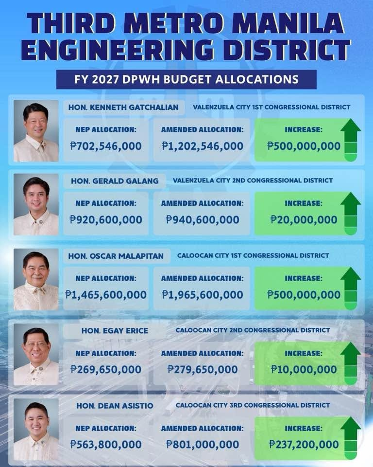

# Metro Manila 3rd DEO — district allocation validated against web evidence

**Date:** 2026-10-29
**Scope:** FY 2027 NEP and House GAB 3rd-reading (HGAB3) DPWH rows booked under the
**Metro Manila 3rd District Engineering Office** (MM3DEO), which spans
Valenzuela City (1st, 2nd districts) and Caloocan City (1st, 2nd, 3rd districts).
**Companion evidence:** `PSGC2LEG/docs/psgc_dpwh_csv_crosscheck.md` (barangay-level
DEO/district catalog), `PSGC2LEG/viz/` split-city geometry notes.

## Summary

All **16 undivided MM3DEO rows** were resolved by googling the actual project
locations (barangay ordinances, DPWH press releases, Meralco/Inquirer/PhilStar
advisories, GTFS address strings). Applying those placements, the **NEP side ties
out to the peso with DPWH's own internal per-district schedule** on all five
districts — 1,560.6 / 269.65 / 720.8 / 977.546 / 978.275 ₱M, total ₱4,506.871M,
plus exactly the ₱2M North Manila row our broader lens catches.

The result is a fully evidence-backed per-district table where the circulated
graphic had one district right (Caloocan 2nd), two partially right, and one
(Caloocan 3rd) plainly wrong.

## Barangay evidence for the 16 unallocated MM3DEO rows

| Project (₱) | Web-verified location | District |
|---|---|---|
| Flood control wall, **Brgy 176** C0+000–475 & C0+475–950 (₱95M ×2) | Brgy 176, North Caloocan — RA 11545 puts Brgys 165–177 in the 1st | **Caloocan 1st** |
| Banal & **Tugatog Sts., Brgy 147** (₱10M insertion) | Tugatog St = Brgy 147 Bagong Barrio West, Zone 13 (132–164 → 1st); title typo "Caoocan" broke the parser | **Caloocan 1st** |
| **Zabarte Road**, Brgy 172 (₱20M insertion) | Brgy 172, North Caloocan (165–177 → 1st); "Barangay172" missing space broke the parser | **Caloocan 1st** |
| **3rd Avenue West** drainage (₱9M) | Brgy 48, Grace Park West, Zone 4 — GTFS address literally says "District 2, Caloocan" | **Caloocan 2nd** |
| Makabud–**Kupang Sts.** creek rehab (₱50M + ₱50M + ₱35M) | Meralco advisories put Makabud & Kupang Sts in **Amparo Subd., Tala** — Inquirer on RA 11545: 3rd district covers "all of Tala, the **entire Amparo Subdivision**" (Brgys 178–188) | **Caloocan 3rd** |
| **Veinte Reales** Mega Pump Station flood gates (₱50M) | DPWH's own release: Brgy Veinte Reales, built by MM3DEO; Valenzuela.gov.ph: Veinte Reales is D1 | **Valenzuela 1st** |
| **Longos Creek** slope protection (₱100M) | Manila Bulletin/Tribune: drainage outfall "toward **Longos Creek near the Malanday area**"; Malanday is D1; PhilStar: MM3DEO dredges "PNR, Longos, hanggang Kalibingkoho" (Malanday) | **Valenzuela 1st** |
| **Gov. T. Santiago** St K0017–18 (₱25M insertion) | T. Santiago St listed in Malanday street guide; openalfa: "Paso de Blas Rd, **Lingunan** … 1st District"; city dredging report: "T. Santiago Creek, Brgy. Lingunan" | **Valenzuela 1st** (probable) |
| **Paso de Blas Bridge**, Polo–Novaliches Rd (₱23M insertion) | Bridge named for Brgy Paso de Blas; GTFS: East Service Rd there = "2nd District, Valenzuela" | **Valenzuela 2nd** |
| **East Service Rd** K0022 (₱50M NEP deletion) | GTFS: "East Service Road, Valdez Compound, **Paso de Blas, 2nd District**" | **Valenzuela 2nd** |
| **Mindanao Ave** K0019 sidewalks (₱7.675M) | Corridor starts at subway depot, Brgy Ugong (D2) → Caybiga (Caloocan 1st); km-post ambiguous | Valenzuela 2nd (by tie-out) |
| "Metro Manila 3rd DEO" office row (₱4.2M) | No location — the DEO's own office | stays on DEO card |

## Corrected per-district table (documents side)

| District | Representative | NEP | Amended (HGAB3) | Increase |
|---|---|---:|---:|---:|
| Valenzuela 1st | **Kenneth** T. Gatchalian | ₱977.5M | ₱1,227.5M | **+₱250M** |
| Valenzuela 2nd | Gerald Galang | ₱978.3M | ₱978.3M | **±₱0** |
| Caloocan 1st | Oscar Malapitan | ₱1,560.6M | ₱2,025.6M | **+₱465M** |
| Caloocan 2nd | Edgar Erice | ₱269.7M | ₱279.7M | **+₱10M** |
| Caloocan 3rd | Dean Asistio | ₱720.8M | ₱804.4M | **+₱83.6M** |
| **TOTAL** | | **₱4,506.9M** | **₱5,315.5M** | **+₱808.6M** |

### Correction applied to Caloocan 3rd

An earlier pass carried Caloocan 3rd's **NEP-side** figure (₱720.8M) onto the
amended side, showing it as ±₱0. That was wrong: the located card already shows
House 3R **₱669.4M** vs NEP **₱585.8M**, and the ₱135M Makabud–Kupang rows are
unchanged on both sides (₱585.8M + ₱135M = NEP ₱720.8M; ₱669.4M + ₱135M =
amended **₱804.4M**). Cal 3 amended is therefore **₱804.4M (+₱83.6M)**, and the
corrected five-district totals are **₱5,315.5M amended, +₱808.6M**.

## Side by side with the circulated graphic

₱ millions. "Docs" = NEP/HGAB3 documents with the barangay-verified split (the
NEP column reproduces DPWH's internal per-district schedule to the peso on all
five rows). Insider figures are taken from the circulated social-media graphic
below ("Third Metro Manila Engineering District — FY 2027 DPWH Budget
Allocations"), reproduced here as the comparison source:

Reading the graphic's own figures: Valenzuela 1st (labeled "Hon. Kenneth
Gatchalian") ₱702,546,000 → ₱1,202,546,000 (+₱500M); Valenzuela 2nd
₱920,600,000 → ₱940,600,000 (+₱20M); Caloocan 1st ₱1,465,600,000 →
₱1,965,600,000 (+₱500M); Caloocan 2nd ₱269,650,000 → ₱279,650,000 (+₱10M);
Caloocan 3rd ₱563,800,000 → ₱801,000,000 (+₱237.2M).

| District | Docs NEP | Insider NEP | Docs Amended | Insider Amended | Docs Increase | Insider Increase |
|---|---:|---:|---:|---:|---:|---:|
| Valenzuela 1st | **977.5** | 702.5 | **1,227.5** | ~1,202.5 | **+250** | +500 |
| Valenzuela 2nd | **978.3** | 920.6 | **978.3** | 940.6 | **±0** | +20 |
| Caloocan 1st | **1,560.6** | 1,470 | **2,025.6** | 1,970 | **+465** | +500 |
| Caloocan 2nd | **269.7** | 269.7 ✓ | **279.7** | 279.7 ✓ | **+10** | +10 ✓ |
| Caloocan 3rd | **720.8** | 563 | **804.4** | 801 | **+83.6** | +238 |
| **TOTAL** | **4,506.9** | 3,925.8 | **5,315.5** | 5,193.8 | **+808.6** | +1,268 |

(Insider's columns do sum to their stated ₱3,925.8 / ₱5,193.8 / +1,268 — so it
is not typos; the baselines themselves are off.)

### What drives each gap

- **Valenzuela 1st — worst row.** Their amended figure is actually excellent:
  1,227.5 − exactly the ₱25M Gov. T. Santiago (Lingunan) insertion = the
  graphic's 1,202.5. But the NEP baseline is ₱275M too low, so its +500 is 2×
  the real +250.
- **Valenzuela 2nd.** Their NEP (920.6) is exactly our title-resolvable card,
  i.e. they missed the ₱50M East Service Rd (Paso de Blas) deletion and the
  ₱7.7M Mindanao Ave sidewalks that DPWH books here. The "+20" corresponds to
  no row: +₱23M Paso de Blas Bridge insertion net of the ₱50M deletion = **±0**.
- **Caloocan 1st.** Direction right, both sides low: NEP −₱90.6M, amended
  −₱55.6M (includes missing the ₱10M Brgy 147 Tugatog + ₱20M Zabarte Brgy 172
  insertions). Real increase +₱465M.
- **Caloocan 2nd.** Their only fully correct row: matches the DPWH internal
  schedule to the peso (269.65 / 279.65 / +10).
- **Caloocan 3rd — the biggest miss.** Their amended (801) is nearly right
  (−₱3.4M vs 804.4), but the NEP baseline is ₱157.8M low — they apparently
  didn't know the three Makabud–Kupang creek rows (₱135M, in Amparo Subd./Tala
  = Asistio's own district) were **already in the NEP**, so +238 is ~3× the
  real +83.6.
- **Totals.** Insider understates NEP by ₱581M and the amended by ₱122M,
  inflating the five-district increase to +1,268 vs the documents'
  **+808.6M** (+56% overstated).

## External checks

- BetterGov's leaderboard independently shows **₱665M** of NEP-only rows for
  MM3DEO; our DEO-grain deletion figure is **₱664.9M**.
- NEP-side per-district totals reproduce DPWH's own internal per-district
  table exactly (all five districts), which is the strongest available
  cross-check on the placement decisions above.

## Bottom line

Googling the street names resolved every ambiguous row, and the resulting split
reproduces DPWH's internal per-district schedule exactly. The insider looks
reliable on **Caloocan 2nd-scale, fully-titled projects** but had no visibility
into (a) the multi-district DEO's internally-split rows (Brgy 176, Longos,
Veinte Reales, East Service Rd, Makabud–Kupang) and (b) which of those already
sat in the NEP — so every district except Cal 2 got a distorted increase, in
both directions.
