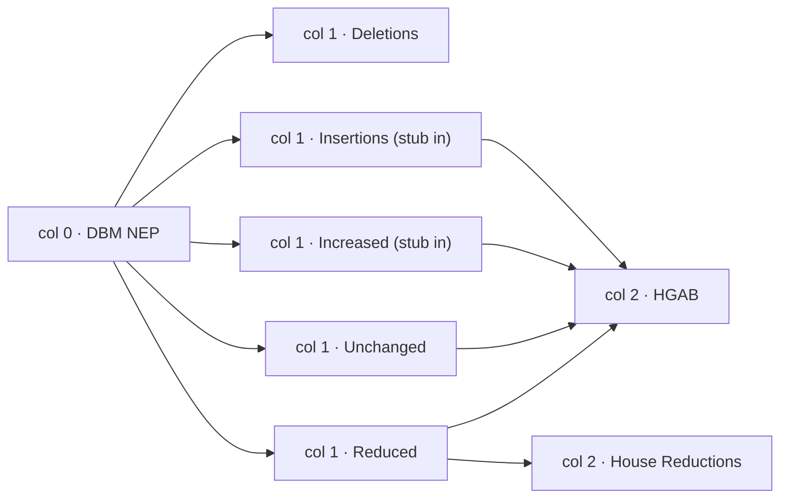

# Budget Flow Diagrams — Implementation Notes

Allocation-flow and membership-alluvial figures on the Experiments workspace  |  FY2027 pilot

Status: Implemented on `#experiments` (unlisted route)  •  Companion to `NEP_HGAB_Budget_Flow_Visualization_Planning_Document.md`  •  All figures below are rendered from validated FY2027 payloads

## 1. What shipped

Two diagram families live on the hidden Experiments workspace, reached only by direct URL (`#experiments`):

| Figure | Files | Unit of flow | Shows |
| --- | --- | --- | --- |
| Allocation flow (one per workspace: DPWH, DA-FMR, DOH-HFEP, NIA) | `analysis/web/src/FlowSankey.jsx`, `overviewFlows.js` | Pesos (Allocations Worth) | How each NEP ledger flows through revision categories into the HGAB ledger. |
| DPWH three-stage membership alluvial | `analysis/web/src/DpwhAlluvial.jsx`, `analysis/web/buildDpwhFlow.mjs` | Comparison rows | Which DPWH comparison rows participate in NEP, HGAB 2nd reading and HGAB 3rd reading. |

Both render through one shared, dependency-free layout engine: `analysis/web/src/columnFlow.js` (~160 lines). The earlier `d3-sankey` dependency was removed entirely.

The Experiments page loads the same validated payloads as the published Overview (`main_overview_2027.json`, plus `dpwh_flow_2027.json` for the alluvial), so every figure remains reproducible and consistent with the workbench tables.

## 2. Why a custom engine

`d3-sankey` was tried first and discarded. Its model is a directed acyclic process graph: node columns and vertical sort orders are *inferred* from connectivity. For budget column-flows this produced three concrete failures:

1. Link-less strata (NEP-only deletions, HGAB3-only rows) were dropped or clamped into invisible slivers, because the algorithm saw no flow to route.
2. Column placement drifted with topology: dead-end sinks (Deletions, House Reductions) migrated into whatever column the search preferred.
3. Ribbons were stroked paths, whose geometry boxes exclude stroke width — invisible to hover hit-testing and to browser assertions.

The replacement engine treats a figure as what it actually is: fixed categorical columns with proportional stacks and ribbons between adjacent axes. That is the alluvial's defining property, and it makes every placement explicit and testable.

## 3. Engine design (`columnFlow.js`)

Pure functions, no dependencies. `computeFlowLayout({nodes, links, stubs, width, height, ...})` returns positioned nodes, ribbon paths, stub paths, column anchors, node label slots and embedded ribbon-label slots.

**Columns are declared, not inferred.** Each node carries `column` (0, 1, 2) and `order` (stack rank within the column). Nothing moves.

**One shared px-per-unit scale.** The scale is the tightest constraint across all columns (`min(available / total)`), so the tallest column exactly fits and every node height is comparable across columns. Each column centers in its leftover space. On the DPWH figure this yields a constant 0.440 px per ₱B on every node (verified: spread 0.0000), which is what makes "HGAB is taller than NEP" visually true (₱587.076B > ₱572.924B).

**Allocated extents.** Each ribbon receives contiguous sub-extents on its source's right edge and its target's left edge. Extent order follows (target column, target order, source order) — with the node orderings used here, ribbons stay parallel and never cross. Extent heights use the same shared scale, clamped to the node edge.

**Filled bezier ribbons.** `ribbonPath` produces a closed `M...C...Z` shape between the two allocated extents. Filled paths carry real area: hoverable, tooltip-capable and visible to Playwright geometry assertions.

**External stubs.** Money that enters the diagram without originating in any left-hand ledger (House insertions, gross additions) is drawn as a short wedge entering the target node's left edge, anchored by a port dot with its own value label. A `lift` parameter raises the port so the entry angles down clear of ribbons routed below; the automatic lift is `max(6px, halfway from entry-center to node top)` — the absolute floor matters because purely relative offsets collapse on very small nodes (DPWH's Increased node is ~5px tall).

**Label slots.** Node labels default to the right of their node; column 0 labels sit left; a node may force `labelSide: 'left'` when its value is a pre-split total (Reduced). Slots push down vertically to stay collision-free. Ribbon values are embedded on the ribbons themselves (see §5), positioned at each ribbon's centerline and de-collided per gap with a 12px minimum separation.

## 4. Graph model and conservation (`overviewFlows.js`)

One workspace's flow graph is derived entirely from its validated summary payload — no new schema. Topology:

Column B ordering (Deletions, Insertions, Increased, Unchanged, Reduced) is deliberate: with HGAB above House Reductions in column C, every fan-out and in-flow is monotonic in node order, so no ribbons cross.

Semantics chosen for honesty over symmetry:

- **Insertions** carry no NEP value (they are HGAB-only records), so they enter column 1 as an external stub — new House money — and flow onward to HGAB.
- **Increased** (labeled "House Additions" in early iterations, renamed for vocabulary consistency) shows its origin split on the left (NEP-base ribbon from col 0 + gross-increase stub) and a single merged ribbon to HGAB on the right. The split is communicated at entry; the exit carries the House value.
- **Reduced** labels on the left because its node value is the pre-split NEP total; its two exit ribbons (House value to HGAB, gross reduction peeled off to the sink) carry the after-values, embedded on the ribbons.

Conservation is asserted at graph-build time — a malformed figure throws instead of rendering (`ensure(...)`):

- NEP out-flow (deletions + additions@NEP + unchanged + reduced@NEP) rebuilds the NEP ledger exactly.
- HGAB in-flow (insertions + additions@House + unchanged + reduced@House) rebuilds the HGAB ledger exactly.
- additions@NEP + gross additions = additions@House (the increased pair reconciles).
- reduced@House + gross reductions = reduced@NEP (the reduced pair reconciles).
- Every kept node is complete (safe integer amount, href, name, sub).

Zero-value groups drop out rather than render zero-width nodes (NIA has no increases, so its figure has 7 nodes / 7 ribbons / 1 stub instead of 8/9/2). Node rects deep-link into the workspace's filtered record populations via the same `links.*` hrefs every other Overview figure uses.

These invariants have caught two real bugs during development: a dropped insertions→HGAB ribbon (rendered as a loud `House in-flow does not rebuild the House ledger` page error) and a tampered adjustment in a unit test.

## 5. Figure conventions

- **Values are embedded, not hover-only.** Every ribbon carries `flowMoney` (3-decimal compact: ₱572.924B, ₱6.3B, ₱15M) at its centerline, haloed white for legibility over fills. Tooltips still carry exact pesos.
- **Number format** is scoped to the flow figures: `flowMoney` in `FlowSankey.jsx`, deliberately distinct from the 4-decimal `compactMoney` used by workbench tables. The page-level "Show exact pesos" toggle switches every figure to full `money` formatting.
- **Colors** reuse the workspace palette: green up (`#0b6b3a`), red down (`#a12020`), tan insertions (`#b0852b`), brown deletions (`#6b5543`), blue adjustments (`#4f7db3`), slate stage ledgers (`#203147`).
- **Accessibility**: each figure is a `<figure>` with caption, `role="img"` and an aria-label restating the ledger totals; ribbons are `<title>`-tooltipped; node rects are links.

## 6. The DPWH three-stage alluvial

`buildDpwhFlow.mjs` partitions DPWH's 17,613 comparison rows by membership across the three printed stages and rebuilds each stage ledger from the strata as an invariant:

| Stratum (NEP/HGAB2/HGAB3) | Rows | Amounts |
| --- | --- | --- |
| true/true/true — in all three stages | 10,079 | ₱497.254B NEP → ₱414.926B both readings |
| false/true/true — House only, both readings | 6,188 | ₱172.016B |
| true/false/false — NEP only (deletions) | 1,341 | ₱75.670B |
| false/false/true — HGAB3 only (annex difference) | 5 | ₱134M |

Stage totals: NEP ₱572.924B / 11,420 rows; HGAB2 ₱586.942B / 16,267 rows; HGAB3 ₱587.076B / 16,272 rows. Ribbons carry row counts (membership is conserved); amounts ride along as node totals. The 2nd→3rd reading change is exactly the five-row annex identity already verified elsewhere in the repository.

## 7. Design decision log

Iterations that shaped the current shape, in order:

1. `d3-sankey` first attempt → orphan-strata clamping, drifting columns, stroked-path invisibility → replaced with the custom engine (§2).
2. Column topology changed from "sources / groups / sinks by connectivity" to the pipeline reading: NEP → revisions → HGAB, with insertions and additions moved into the middle column and gross reductions peeling off at the end.
3. Increased (then "House Additions") initially split into two ribbons on the right (NEP base + increase, mirroring Reduced's exit split); reverted to a merged exit because the entry side already shows the split — splitting both sides communicated the same fact twice and crossed the node.
4. Node heights initially normalized per column (each column filled its height), which made the lone NEP node taller than the larger HGAB node; fixed with the shared scale (§3).
5. Ribbon values embedded after hover-only tooltips proved insufficient for reading; per-gap de-collision added because DPWH's Increased entry labels initially collided.
6. Stub lift made absolute-floored after a purely relative offset produced a ~1px separation on the 5px-tall Increased node.
7. Reduced's label moved to the left side (pre-split value) once exit ribbons carried the after-values.
8. "House Additions" renamed to "Increased" to match the five-group vocabulary used everywhere else (Overview tiles, tables, workbench filters).

## 8. Verification

- **Unit tests** (`mainOverview.test.js`): flow-graph conservation per workspace, stub-aware in = out, zero-group dropout, href completeness, and a tamper test that mutates an adjustment and expects a throw. Current state: 233 pass / 0 fail.
- **Browser checks** (`scripts/check_overview_pages.py`): the `#experiments` route renders (node/ribbon counts asserted per figure), stays hidden from navigation, and the Overview carries no flow figures. Passes at 390px and 1440px.
- **Geometry audit** (ad hoc, during development): every ribbon/stub path parses without NaN, bounding boxes stay in-viewBox, all 72 labels in-bounds, shared-scale spread 0.0000 px/₱B, Reduced label anchored left on all four workspaces.

## 9. Relationship to the planning document and open work

This implementation covers the planning document's single-agency MVP geometry (its §9), with two deviations by design: the revision taxonomy is rendered at workspace grain rather than PAP-scoped (planning §2's stages B–D remain unbuilt — PAP-scoped revision cells are the natural next experiment), and insertions/deletions are modeled as stub-entries and dead-end exits rather than starting/terminating "at Stage C".

Open items carried from the planning document: PAP-scoped grouping, selection/highlight interaction, detail panels and drill-down, exports with provenance footers. The engine's declared-column model was built to admit the PAP-scoped variant without layout changes — adding a column is a data change, not an engine change.
