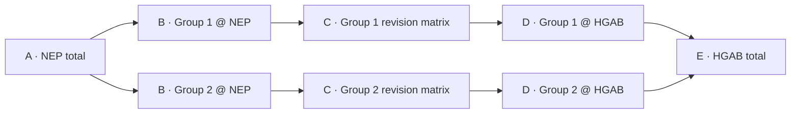
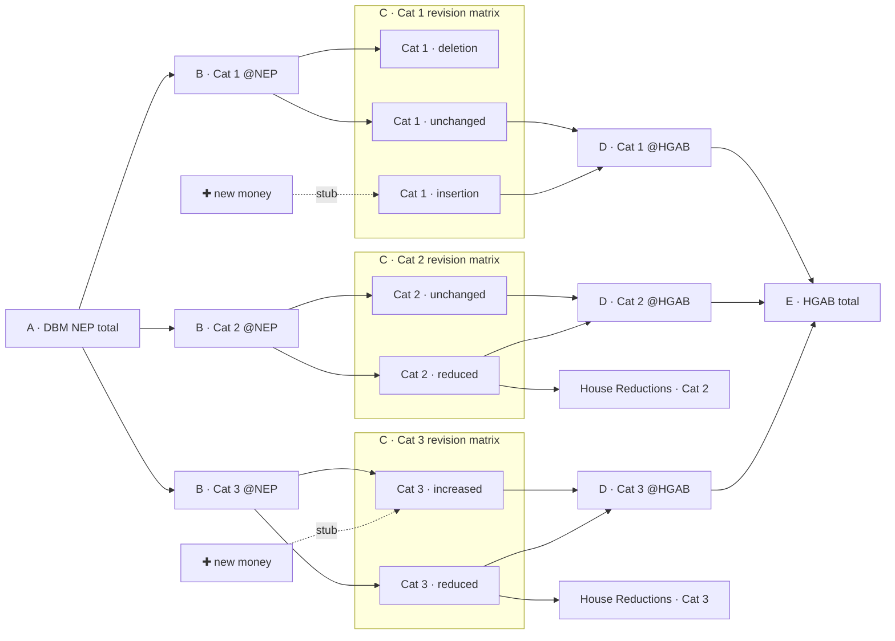

# Budget Flow Visualization

Concept and implementation record  |  Reusable 2027 NEP → HGAB flow

Status: Implemented experiment  •  Scope: five-stage, intermediary-scoped revision flow  •  Sources: DPWH, FMR, HFEP and NIA

## 1. Executive concept

Build an interactive, five-stage visualization that traces budget allocations
from the original NEP through a selected intermediary and an intermediary-specific
revision matrix to the revised HGAB. The objective is to show the scale,
direction and composition of budget edits, rather than only the net difference
between headline totals. Dataset and intermediary selectors reuse the same graph,
layout and renderer.

The graphic is a multi-stage budget flow diagram. Allocations change between versions through explicit addition stubs and deletion/reduction endpoints. Each individual band preserves its thickness, and the complete graph reconciles both source ledgers. The reusable implementation uses custom SVG geometry.

## 2. Agreed five-stage structure

| Stage | Name | Meaning / node structure |
| --- | --- | --- |
| A | NEP budget overview | One node: the selected dataset's total NEP allocation. |
| B | Intermediary groups at NEP | One node per selected group, measured at NEP values. |
| C | Scoped revision matrices | Within EACH group: Inserted, Unchanged, Increased, Decreased, Deleted. |
| D | Intermediary groups at HGAB | The same group identities, measured at HGAB values. |
| E | HGAB budget overview | One node: the selected dataset's total HGAB allocation. |

**Critical design rule:** Stage C is not a shared set of five global revision
nodes. Every intermediary owns its own five-cell matrix, preserving group
identity throughout B → C → D.

*Figure 1. Conceptual topology only; the implemented SVG uses proportional values.*

## 2a. Recursive revision-matrix structure (agreed refinement)

The five-stage flow applies the workspace-level allocation-flow grammar
(`tab=flows`) **recursively per intermediary group**. Category is the default
DPWH example, but the same rules apply to PAP, region, office and the other
recorded groupings:

- **Column C is grouped per intermediary**: each group owns a contiguous five-cell revision matrix — `deletion → insertion → increased → unchanged → reduced` — in the same fixed order as the workspace figure's Column B. Zero-value cells are omitted; the remaining cells keep their rank so blocks stay visually comparable.
- **Group blocks follow the Column B order** (largest NEP value first), so B→C ribbons fan out into a block and C→D ribbons converge back out of it without crossings.
- **New House money has no source node.** Each insertion cell enters from a floating stub carrying the full cell value; each increased cell receives its NEP base from Column B *plus* a floating stub carrying only the gross-up. Same affordance as the workspace figure's stubs.
- **House Reductions is per group**: each reduced cell sends its House value onward to Column D and peels its gross reduction into a `House Reductions · <group>` sink directly below that group's HGAB node. Never one global sink.
- **Deletion cells terminate in Column C** — inflow only, no outgoing ribbon.

Illustrative with three intermediate category groups (`✚` = floating new-money stub; only non-zero cells drawn):

*Figure 2a. Recursive revision matrix, three sample categories. Reading Cat 2: its NEP base splits into `unchanged` (passes straight through) and `reduced`; the reduced cell forwards the smaller House value to `Cat 2 @HGAB` and peels the gross reduction into `House Reductions · Cat 2` sitting below it. Cat 1 shows a dead-end deletion cell and a full-value insertion stub; Cat 3 shows an increased cell fed by its NEP base plus a gross-up stub. Per-category sinks appear only where reduced records exist.*

## 2b. Reusable builder implementation

The Budget flow tab now expresses this structure through a general builder:
**Total A → Intermediary A → Revision Matrix → Intermediary B → Total B**.
The core accepts grouped `before`/`after` values and counts; labels, currency,
grouping policy and evidence links are supplied by dataset adapters. DPWH
Category keeps FAPs as a separate mutually exclusive group. DPWH PAP, Region
and DEO/implementing office, plus the retained FMR, HFEP and NIA dimensions,
reuse the same graph, layout and SVG renderer. The three-stage Allocation flows
adapter shares the revision topology.
See [Revision Flow Builder](Revision%20Flow%20Builder.md) for the API,
matched-record helper, non-budget example and validation contract.

## 2c. Compact display variation: top three plus Others

The default Budget flow display details the three largest intermediary groups
at NEP values and combines the remaining groups into a final **Others** group.
The rank is fixed from NEP and reused at B, C and D. Others stays last. It has
its own revision matrix and reduction sink, with cells formed by summing the
corresponding original revision cells; the aggregate net change is never used
to reclassify records. All allocations, row counts and gross changes remain
included at the same monetary scale. The default therefore draws at most four
blocks: the top three plus Others.

Selecting Others exposes its constituent groups and available evidence links.
**Expand Others** or the detail selector's **All** option restores the full
figure. Diagram and section exports follow the chosen display variation.

## 2d. Dataset and intermediary selectors

The Budget flow tab now offers **Dataset source** and **Intermediary source**.
The same builder and renderer accept DPWH, DA Farm-to-Market Roads, DOH Health
Facilities and NIA Irrigation. Intermediary options follow their retained
fields: DPWH Category/PAP/Region/DEO, FMR Region, HFEP facility headings,
Region/Province/funding component, and NIA Sub-program/Program group.
Changing a grouping does not rematch records. The source scope and record
count unit remain explicit; HFEP uses funding-column records. Selections are
shareable in the URL and retained in image exports. See the
[builder documentation](Revision%20Flow%20Builder.md) for grouping policies,
source adapters, reconciliation and evidence-link behavior.

## 3. Stage C: revision taxonomy and semantics

| Revision type | Record-level rule | Flow behavior |
| --- | --- | --- |
| Inserted | Present in HGAB; no verified matching NEP record. | Begins at C and proceeds to D, then E. |
| Unchanged | Matched record, same comparable allocation. | B → C → D; same value on both sides. |
| Increased | Matched record; HGAB amount > NEP amount. | B → C carries NEP; C → D carries HGAB. |
| Decreased | Matched record; HGAB amount < NEP amount. | B → C carries NEP; C → D carries HGAB. |
| Deleted | Present in NEP; no verified matching HGAB record. | A → B → C; terminates at C. |

Classification is applied to the underlying project or comparable line-item
record before aggregation. One intermediary group can therefore have allocations
in multiple revision categories at the same time. An unchanged group total does
not mean its constituent records were unchanged.

Missing matches require a separate data-quality flag. An unconfirmed match must not automatically be treated as a genuine insertion or deletion; the visualization can exclude or separately disclose unresolved records until matching confidence is sufficient.

## 4. Amounts and accounting model

For each matched record i, let Nᵢ be its NEP amount and Hᵢ its HGAB amount. Revision classification is based on Nᵢ and Hᵢ after units, comparability and matching have been validated.

- NEP-side flow for a group and revision type: sum of Nᵢ across records in that class; zero for Inserted.
- HGAB-side flow for a group and revision type: sum of Hᵢ across records in that class; zero for Deleted.
- Gross increase = sum max(Hᵢ − Nᵢ, 0), including new HGAB-only records as Nᵢ = 0.
- Gross decrease = sum max(Nᵢ − Hᵢ, 0), including NEP-only deleted records as Hᵢ = 0.
- Net change = gross increase − gross decrease = HGAB total − NEP total, subject to complete and comparable coverage.
The principal visual emphasizes the left-side and right-side amounts for every
revision cell instead of compressing them into one net change. Every ribbon
keeps the same thickness at both ends. Explicit addition stubs and reduction
sinks account for the difference between the two sides on one consistent scale.

## 5. Worked intermediary example (illustrative only)
Suppose a single intermediary group has these underlying record-level outcomes.
This intentionally demonstrates offsetting gross changes within one group.

| Revision cell | NEP side | HGAB side | Difference |
| --- | --- | --- | --- |
| Inserted | ₱0B | ₱50B | +₱50B |
| Unchanged | ₱30B | ₱30B | ₱0B |
| Increased | ₱20B | ₱35B | +₱15B |
| Decreased | ₱40B | ₱15B | −₱25B |
| Deleted | ₱10B | ₱0B | −₱10B |
| TOTAL | ₱100B | ₱130B | +₱30B |

The net change is +₱30B, but the underlying gross revisions are ₱65B in increases/insertions and ₱35B in decreases/deletions. Both should remain visible. These are hypothetical values, not DPWH findings.

## 6. Recommended screen layout and behavior

At desktop widths, the five stages use one horizontal canvas with coordinated
group rows. Stage C shows a compact five-cell stack per group. The same order is
held across B, C and D, which avoids crossings. By default, each group's outer
ledger segment is vertically matched to its B/D nodes so its complete path reads
as one horizontal band. Top-aligned and centered total-ledger views remain
available for comparison.

- Overview totals show NEP, HGAB, gross additions, gross reductions and net change.
- Hover, click and keyboard selection highlight one group or one revision type.
- The detail panel shows both ledger values, delta, record count and evidence links where the target workspace can express the same population.
- Dataset, intermediary, detail and alignment controls are URL-backed.
- Small screens use a horizontally scrollable canvas with persistent stage headers.
- SVG and PNG download the figure; section PNG includes the heading, totals, figure, detail, table and source notes.

## 7. Interaction and rendering decisions

| Decision area | Implemented behavior |
| --- | --- |
| Flow geometry | Custom SVG ribbons use one exact value scale. Each individual band has equal width at both endpoints. |
| Stage C nodes | Five fixed-order revision cells within each group. Zero-money cells remain in the model and are omitted from the drawing. |
| Colors | Use consistent revision-type colors; add text/icon cues so color alone does not carry meaning. |
| Cross-group transitions | No transfer is inferred. Every retained record pair belongs to one stable intermediary identity. |
| Insertion/increase | A rectangular floating stub carries the full insertion or only the increase gross-up. |
| Reduction/deletion | Every reduced cell has its own sink; a deletion ends in Stage C. |
| Density control | Top three groups by NEP plus a revision-by-revision Others rollup; full detail remains selectable. |
| Exports | Self-contained SVG, figure PNG and full-section PNG carry the selected source, grouping and provenance. |
| Layout library | Bespoke React/SVG geometry; D3 is not used. |

## 8. Data preparation and validation

Implementation depends more on correct record reconciliation than on the drawing library. Before producing a proportional flow, establish:

1. Source coverage: consistent NEP and HGAB definitions, fiscal year, agency, currency/unit and included line-item scope.

2. Intermediary identity: stable IDs and display labels for the selected grouping level.

3. Record matching: stable keys where available, plus documented composite/fuzzy matching policies and manual review for ambiguous cases.

4. Revision derivation: assign exactly one revision type per normalized, comparable record pair or unmatched record.

5. Aggregation: group by intermediary × revision type and calculate NEP-side, HGAB-side, delta and counts; preserve record IDs for drill-down.

6. Reconciliation: Stage B sums to A, Stage D sums to E, and every C-side sum reconciles to its adjacent group totals; disclose any exclusions.

The current adapters retain the repository's existing matching. They do not
infer renamed projects, split/merged line items, geography, transfers or
cross-group reclassification. Zero-value records and differing source grains
remain explicit in the model and source notes.

## 9. Implemented scope and acceptance criteria

The experiment supports four retained datasets and twelve intermediary choices.
It validates every choice against its source ledgers before generating the small
browser catalog. Matching remains provisional wherever the underlying workspace
defines unmatched rows as insertion/deletion candidates.

| Acceptance test | Pass condition |
| --- | --- |
| Group-scoped Stage C | Each rendered revision cell has both a group ID and revision type; global five-node merging never occurs. |
| Monetary reconciliation | Displayed A/B and D/E sums exactly match the validated integer source ledgers. |
| Gross-change visibility | A group with increases and decreases simultaneously shows both classes, even if net = 0. |
| Insert/delete behavior | Inserted records have HGAB-side flows only; deleted records have NEP-side flows only. |
| Traceability | Exact scoped links are used where supported; other dimensions are explicitly linked to the unfiltered comparison workspace. |
| Export integrity | Export includes current grouping and selection, units, source/version label and caveat text. |
| Performance | The browser loads a generated source catalog instead of the large raw workbench payloads. |

## 10. Implementation structure

1. `revisionFlow.js` validates normalized cells and builds the reusable graph.
2. `revisionFlowLayout.js` lays it out with one proportional scale.
3. `RevisionFlowDiagram.jsx` renders the accessible custom SVG.
4. `flowSourcesData.js` adapts and validates retained dataset records.
5. `BudgetFlowExplorer.jsx` owns dataset/intermediary selection and URL state.
6. `BudgetCategoryFlow.jsx` supplies budget labels, evidence links, compact detail and exports.

The detailed API, source policies and validation commands are recorded in
[Revision Flow Builder](Revision%20Flow%20Builder.md).

## 11. Remaining design questions

- Should analysts be able to change the top-group count, or should Top 3 stay fixed for comparable exports?
- Which currently unscoped dimensions should their comparison workspaces learn to filter?
- Should a later data model represent verified cross-group reclassification explicitly?
- Which source-specific terminology needs editorial review before publication?
- Should the experiment graduate into an existing dashboard module or remain a dedicated explorer?

## 12. Communication and interpretation safeguards

The visualization demonstrates observed changes between two budget documents. It must not suggest that cuts in one project directly funded additions in another unless independent evidence supports that transfer. Labels should distinguish "increase", "decrease", "insertion" and "deletion" from claims of intentional reallocation.

The four source adapters preserve their workspace definitions and provenance.
Any narrative claim derived from the visualization still needs a cited,
publication-ready calculation; the experiment itself establishes reconciliation
and traceability, not intent behind a budget change.
