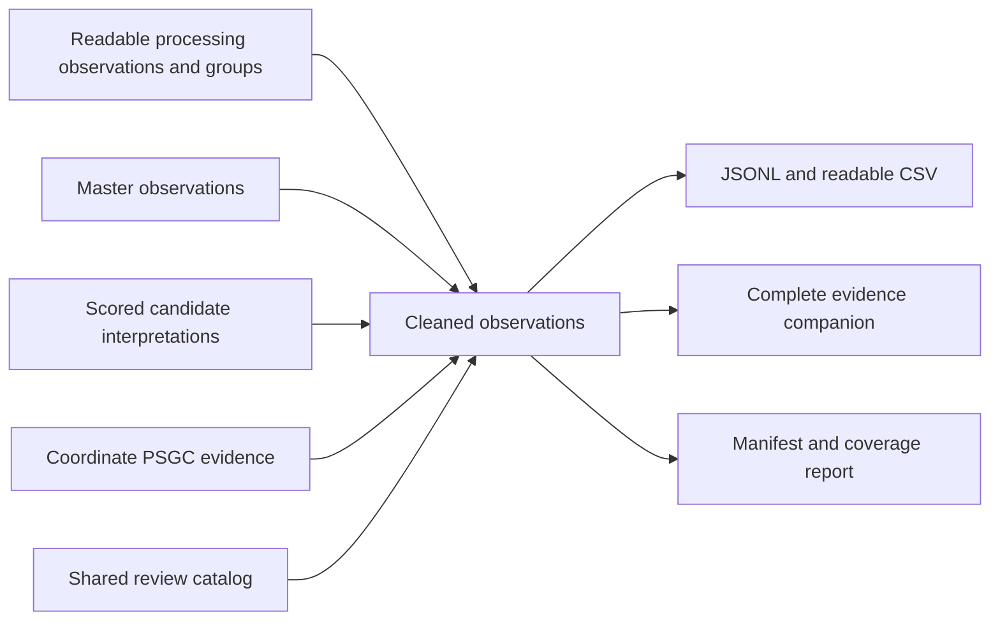

# Cleaned source observation release

**Schema:** `cleaned_observations_v1` · **Adoption:** `candidate_trial_adoption_v1`  
**Questions:** `review_questions_v1` · **Catalog:** `review_catalog_v1`  
**Status:** implemented consumer release and viewer tab; provisional selections,
no human verification.

The [builder](../scripts/build_cleaned_dataset.py) joins the readable processing
release, master observations, full location interpretations and coordinate-PSGC
evidence. It creates a separate release under `data/cleaned/`. Every existing
`record_id`, source title, amount and comparison attachment is retained. Rows
remain source observations, not deduplicated physical projects. Source and
House-reading amounts must stay separate.



## Files

| File | Contents |
|---|---|
| `observations.jsonl.gz` | One cleaned row per source observation, including selected provisional locations and compact review questions |
| `observations.csv.gz` | Same observation grain with readable titles, locations, expanded question labels and requested information |
| `evidence.jsonl.gz` | One companion per observation: original master location, complete interpretation, every candidate and its full assessment, comparison context and available coordinate mapping |
| `comparison_groups.jsonl.gz` | Exact retained processing groups, including complete stage annotations, matching details and member observation IDs |
| `review_catalog.json` | Exact versioned flag/status vocabulary copied into the release |
| `manifest.json` | Schema/policy versions, input and output hashes, per-dataset counts/amounts and decision/question totals |
| `REPORT.md` | Human-readable counts and limitations |

These regenerable local artifacts are Git-ignored. Export the full release
directory to preserve its evidence and catalog references.

The group collection retains details that belong to an aggregate stage or
repeated-key group, including shared chainage/geometry annotations. Keeping
their original group scope avoids treating those details or aggregate amounts
as individual findings on every member observation. It is a linked comparison
collection, not additional funding or new source observations.

## Observation fields

The cleaned row carries the master row's source and enrichment fields, including
readable/source titles and cleanup rules, program information, implementing
office, source region, source PDF/page details, retained `analysis_record`,
coordinate summaries and normalized geometry where supplied upstream.

The following fields provide the new consumer contract:

| Field | Meaning |
|---|---|
| `comparison` | Partition and stage context, plus an evidence reference to retained upstream comparison metadata |
| `original_location_ref` | Record-local reference to the exact original master `location` object |
| `original_master_score`, `original_master_score_method` | Original score ledger, without renaming it candidate confidence |
| `location_resolution` | Current provisional selection, status, decision, target level, unresolved levels and alternatives |
| `candidate_support` | Method, best assessed candidate, its total/vector and retained trial status; best candidate can differ from the selected one |
| `review_flags` | Compact code/status/evidence-reference entries; shared wording is stored once in the catalog |
| `legacy_legislative_district` | Existing district result, when present, preserved under an explicit legacy name; not recomputed or asserted against the new selection |

The old top-level `location` and `legislative_district` objects are replaced by
those explicit consumer fields. All source fields are checked against the
processing observation before and after enrichment; they cannot be overwritten
by a location decision. Complete original location factors and technical review
flags remain in the evidence companion. Comparison group membership does not
transfer evidence to another observation.

Each selected location contains its PSGC code/name/level, catalog ancestry,
selection origin, claim scope, selected candidate's existing score vector,
quality/scope states, warnings and full-assessment reference. Missing spatial
or registry support stays `null`. City ancestry is not converted into a
province for independent cities.

## Selection policy

The task is useful **city/municipality identification** for later geographic
processing. A supported barangay is retained but is not required for every
record. Whole-project extent is not a requirement of this release and remains
`not_assessed`. Legislative-district derivation is deferred.

For project/facility/FAP observations:

1. Consume an existing `ready_for_trial` proposal from the hash-validated
   interpretation release. Require its own candidate to be eligible, have no
   blockers, use the mapped-coordinate or existing-title-gate route, and carry
   the recorded proposal scope. Registry-only proposals are not adopted.
2. Recheck that eligible candidates form one compatible ancestry chain, the
   proposed candidate is deepest, and the proposal contains every originally
   selected master location in its ancestry. A new point cannot erase part of
   a multiple-location assignment or replace an incompatible location.
3. Select the candidate provisionally in this new release. GPS selections have
   scope `observed_coordinate_points`; title-gate selections have scope
   `title_locality_claim`. Adoption adds no points and does not create a new
   confidence percentage or a fixed applied-layer score.
4. Otherwise retain all original master locations, with their original
   interpretation available for audit. Retention is not a claim that the new
   trial gates were passed. A retained registry location is explicitly scoped
   to `registry_asset_location`; other retention uses
   `retained_master_interpretation`.

Non-site allocation kinds receive `not_applicable` and no project-site
questions. This follows record kind, not whether the observation has a
comparison counterpart.

`decision` is `adopted_candidate`, `retained_master`, `review_required`,
`unresolved` or `not_applicable`. `status` independently describes the current
location interpretation: resolved for the declared task/scope, partially
resolved, ambiguous, unresolved or not applicable. A retained selection can
remain present while a conflict leaves its status ambiguous. Missing barangay
detail is recorded in `unresolved_levels` even when the city-level task is
resolved. Verification stays `provisional`, never inferred from score or
absence of questions.

Original master assignments, the legacy applied-suggestion layer and all their
scores are consumed read-only. The viewer's Source data tab retains them
alongside the separate Cleaned data tab.
Coordinate-reference freshness and positional accuracy retain their unassessed
limitations; decimal precision does not establish accuracy.

## Question-generation policy

The shared [review contract](REVIEW_DATA_CONTRACT.md) defines six possible
questions. This first generator enables only three:

- `location_unclear`: no useful selected city/municipality,
  and no more specific conflict/alternatives
  question already explains the gap. A province-only interpretation is
  retained and receives this question.
  A partial interpretation that already includes a useful city alongside
  broader province context does not receive this generic question merely
  because the broader scope remains coarse.
- `location_alternatives`: while no useful city-level locality has been selected,
  admitted, scored, asserted title candidates have specific parent/province/
  heading/office support, have no province/region/heading/registry conflict,
  and span more than one city/municipality. Candidates blocked by asserted
  title, existing title-application or spatial-scope conflicts are excluded.
  National name pools alone are
  insufficient. Several already-selected locations are not competing
  alternatives. An adopted trial proposal does not receive this question.
- `location_conflict`: a title-only reading selects one locality and all valid,
  completely mapped coordinate points agree on a different locality at that
  same level. Invalid/partial mappings, known coordinate-quality issues,
  multiple title locations, mixed-point coverage and absent province parents
  do not trigger it. This requests clarification of the locality/coverage; it
  does not establish which source is wrong. Source region or DEO name
  disagreement alone is insufficient.

The other catalog codes remain reserved. `project_coverage_unclear` needs an
explicit extent requirement or documented missing segment, not merely a point
scope. `description_unclear` needs a material source-description issue rather
than readable-title repairs. `record_relationship_unclear` needs specific
counterpart evidence and related record IDs; membership labels are insufficient.
This release does not infer those requirements or questions.

All generated questions start `open`, with stable evidence references. No
requests are sent and no responses/human review events are imported. Empty
flags mean no questions generated, not verified correctness. Inclusion,
office associations and questions imply no representative's responsibility
for an item.

## References, integrity and rebuild

Evidence IDs are record-local: resolve the pair `(record_id, evidence_ref)` in
`evidence.jsonl.gz`'s `items` object. `candidate:<PSGC code>` is stable across
candidate reordering; `master_location`, `interpretation`, `comparison` and
`coordinate_psgc` identify the retained evidence collections. The complete
profile is reconstructible from `interpretation` plus the candidate items;
candidate ordering is not part of its meaning. Raw parser mention IDs remain
upstream evidence, not new stable public references. Every generated question,
selection and alternative reference is checked before writing.

The manifest pins the actual processing release and its direct dependencies,
master/profile/coordinate outputs and audits, PSGC catalog, review vocabulary,
builder and policy helpers. It does not upgrade reference freshness beyond
what the upstream audits establish. The builder rejects stale inputs, altered
source values, duplicate/missing observations, identity/order differences,
orphan coordinate/group members, stage amount discrepancies and per-dataset
count/amount differences. Its manifest records amounts separately per dataset.
Gzip timestamps and JSON serialization are deterministic; `--check` regenerates
and compares every artifact without replacing the retained release.

With current upstream layers already generated:

```sh
python3 master_list/scripts/build_cleaned_dataset.py
python3 master_list/scripts/build_cleaned_dataset.py --check
python3 -m unittest master_list.tests.test_cleaned_dataset master_list.tests.test_review_catalog -v
```

Use `--out <directory>` for a separate output directory. The web package also
provides `npm run build:cleaned-data --prefix analysis/web`. Its existing
`build:master-list` command now generates this consumer after interpretations.
Rebuild the viewer after changing the cleaned release. Upstream evidence does
not need rebuilding when only the cleaned policy changes.

## Viewer

Open `/master_list/#cleaned`, or choose **Cleaned data** above the Browse
controls. The tab includes all observations and shares source, category,
comparison-membership and allocation filters. Additional filters select
location status, selection decision, clarification question and minimum
selected support. **Needs clarification** uses the generated questions,
separately from the master parser's technical `needs_review` field.

The location column shows the selected provisional places and their claim
scopes. Each place has its own Text/Spatial/Context/Registry support vector
and evidence disclosure. Sorting/minimum support uses the lowest selected
score when every selected place is assessed; otherwise that row is unassessed
and sorts last in both directions. Scores are never summed across locations.
Original master score and best-candidate support remain separate disclosures.
Cleaned search covers selected locations and question labels; alternatives
remain in the evidence.

Questions show catalog wording and requested information. **View clarification
evidence** opens their exact referenced evidence. **View data** and its JSON
download include the full cleaned observation, complete record-local evidence
and original source details. The header download switches to cleaned CSV;
JSONL, evidence, catalog and report links are also available. Empty flags do
not mean verified correctness.

**Source data** restores the original views and scores. The cleaned tab also
works from `index.html` on disk with `data/record_details` beside it. Viewer
manifest schema 7 pins the cleaned release, including catalog and evidence.
The builder rejects stale files and mismatched identities or shared evidence;
bounded on-demand packets reuse original evidence instead of loading the full
corpus into the initial page. A separate human-response workflow can later
supply recorded review events.
