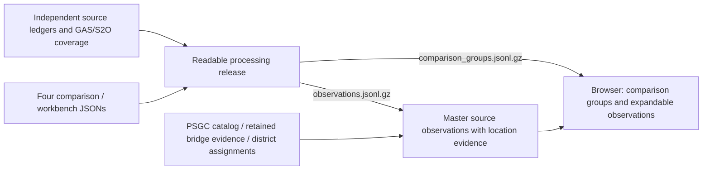

# Master list location evidence: work log and roadmap

**Status:** additive evidence version 6.2 built and verified on the readable processing release (2026-10-26)\
**Score field:** `location.score` · **Scoring rules:** [SCORING_RULES.md](SCORING_RULES.md)\
**Method identifier:** `location_evidence_v6.2` · **Title cleanup:** `readable_title_v1`

This document records what the master-list work has done, how the location
parser now reasons about place mentions, and how the raw scores should be
assessed before any normalization. A score may change only when source evidence
or a documented rule changes.

Use [PROCESSING_DATASET.md](PROCESSING_DATASET.md) for source selection, readable
titles, comparison membership and the browser contract. Use
[SCORING_RULES.md](SCORING_RULES.md) for the current factors and weights. This
document connects that pipeline to the location methodology, historical
changes, current build statistics and remaining review work.

## Current pipeline and record layers



`build_processing_dataset.py` preserves existing upstream matches, restores
their enriched stage records, and adds conservative readable titles. It
accounts for 20,321 comparison groups covering 59,601 source observations,
plus 5,044 House GAS/S2O observations classified `not_compared`. The latter
are outside the operations comparison scope; no counterpart matching was
performed for them.

`build_master_list.py` consumes the validated processing observations and
adds per-observation location findings. `projects.jsonl.gz` retains all
64,645 original `record_id` values, source titles, integer PHP amounts and
provenance, together with `comparison_group_id`, `comparison_stage`, readable
title metadata, and available `analysis_record` annotations. The evidence
layer adds `location`, its score/factors/review flags, coordinate summaries,
and legislative-district derivations. A comparison attachment does not
certify physical-project identity or transfer a location to another member.

`build_viewer.py` joins those findings to the same processing groups. It
verifies the release hashes pinned by the master audit, group membership
and stage/member amounts. Each source and reading keeps its own amounts;
there is no combined group location score or multi-source budget total.
The processing step remains independent of generated master/bridge outputs;
the master enrichment still reads retained bridge evidence. See the
[provenance map](../../analysis/docs/data_provenance_map.md#43-master-list-collation-master_list)
for that existing dependency and its freshness limits.

## Version 6 changes

This historical summary describes the v6 release. Version 6 addresses false
penalties on multi-barangay titles, split-name
municipalities, numbered barangays, and city districts:

1. **Initial-dropping town aliases.** PSA names carrying personal initials
   (`Pres. Manuel A. Roxas`) are also indexed without single-letter tokens
   (`pres manuel roxas`), so titles writing `Pres. Manuel, Roxas` resolve.
2. **Comma-spanning phrases.** A catalog name may span a comma inside a
   bounded suffix when the phrase does not fit inside any single part; it
   then qualifies as locality syntax for that phrase alone.
3. **Province-first barangay scoping.** Barangay candidates are narrowed to a
   stated province before uniqueness, preventing homonym barangays under
   same-named towns in other provinces from poisoning the context.
4. **Multi-marker capture.** Every `Brgy.`/`Barangay` marker in every part is
   examined (previously only the first per part); grouped barangays under one
   municipality waive per-marker conflict/ambiguity flags and record
   `grouped_barangays_under_same_municipality`.
5. **Numbered-barangay comma join.** A marker part ending in a bare number
   (`Barangay 1`) joins the following part when the joined words form a
   catalog alias (`1 san lorenzo` → `Bgy. No. 1, San Lorenzo`, Laoag City);
   the absorbed part is suppressed from town scanning.
6. **City-district context.** A conflicting town mention that is positionally
   explained by a barangay's accepted parent city (`Jaro`, `La Paz` in Iloilo
   City) records `city_district_context` instead of a hard province conflict.
7. **Parenthetical qualifier disambiguation.** Same-named barangays inside one
   city (`San Isidro (Jaro)` vs `San Isidro (La Paz)`) resolve when the title
   mentions the parenthetical district elsewhere.
8. **Explicit-city marker scope.** An explicit city phrase (`Iloilo City`)
   outranks same-named town homonyms when scoping barangay markers.

At the v6 release: `title_or_heading_province_conflict` 323 → 169, `ambiguous`
status 349 → 195 records; 620 records carried the grouped-barangay bonus.
These are historical release measurements. The current snapshot is below.


## What we have done

The master list enriches 64,645 FY2027 source observations from ten retained
DPWH, farm-to-market road, health-facility, and irrigation datasets. Each source
and budget stage remains a separate ledger. Titles, categories, integer PHP
amounts, source identifiers, PDFs, pages, coordinates, and source hashes remain
traceable. All ledgers reproduce their source controls; the known PHP 140,000
HFEP source discrepancy remains disclosed.

The first location release used a bounded `0.00`–`1.00` rules score. We removed
that presentation before calibration because the decimals looked probabilistic
and the cap hid how much evidence a row actually contained. The replacement is
an uncapped additive score. Existing categorical statuses remain as explanations,
while each positive and negative factor is retained on the record.

The viewer starts with **Comparison groups**, showing 20,321 groups and
separate stage amounts. Expanding a group reveals its source observations:
readable titles, categories, original titles and cleanup rules, provisional
PSGC locations, raw evidence scores, coordinate/district details, and PDF-page
links. Retained comparison/stage details expose upstream match status,
chainage, normalized geometry and review annotations.

**All source observations** shows all 64,645 rows, and **Outside comparison**
shows the 5,044 GAS/S2O observations. Allocation rows are initially included.
Search and source/category/minimum-score/location-review filters apply to
individual observations; a group is selected when at least one member meets
every filter. Expansion shows all members and marks those matching the
filters. Group amounts remain complete-stage amounts, while the filtered
source total uses only matching observations. Amount sorting in group view
requires one source; score sorting is available in observation views.

## How a human-style parse is approximated

The parser first collects plausible place mentions, then tests their PSGC
relationships instead of deciding from one name in isolation:

1. Start with `title_clean` from the processing release, retaining the original
   `title`/`title_source` and cleanup metadata. The readable layer repairs
   split `ñ`/`Ñ`, explicit HTML entities, Unicode composition and whitespace
   without spelling guesses or numeric rewrites. Then normalize punctuation,
   accents, `Sta.` and `Sto.`, and documented
   historical spellings (`North Cotabato` → `Cotabato`, `Compostela Valley` →
   `Davao de Oro`, `Western Samar` → `Samar`, `Pob.` → `Poblacion`), while
   retaining the source title unchanged.
2. Detect complete catalog names at word boundaries and record every candidate
   PSGC code for repeated names.
3. Identify locality syntax: comma suffixes, municipality/city/province labels,
   `Brgy.`/`Barangay` markers, and exact printed locality headings.
4. Test candidate chains using actual `parent_code` relationships:
   barangay → municipality/city → province → region.
5. Prefer a barangay candidate whose named town and province form the stated
   hierarchy. A source region may disambiguate remaining town or barangay
   homonyms when it leaves one regional candidate.
6. Accept an unmarked barangay only from a complete ordered
   `barangay, municipality, province` suffix and only when no same-named town is
   valid in that province.
7. Treat a compact component such as `Claver Surigao del Norte` as locality
   syntax only when catalog place names cover every word in the component.
8. Retain conflicts, unmatched markers, ambiguous candidates, and multi-place
   projects for review rather than silently forcing one answer.

Sitios and puroks are useful text context but are not PSGC administrative units.
Implementing-office names remain context and are never assigned as project
sites. Parsed title coordinates and normalized FMR coordinate pairs are
retained for review and currently add no score factor. Existing bridge-registry
evidence is an exception: exact IDs, unique retained spatial chains and
agreement/conflict contribute their documented factors. Legislative-district
lookups remain unscored. Coordinate parsing uses the original title to retain
source fragments; normalized FMR coordinates take precedence in the coordinate
summary. Location name inference uses `title_clean`, recorded in
`location_title_field`.

## Raw additive scoring rules

The complete rule tables — bases, evidence bonuses, corroboration bonuses, the
coherence bonus, penalties, a layering diagram, and worked examples — now live
in the dedicated [SCORING_RULES.md](SCORING_RULES.md). The tables below are
kept only as a quick reference; the canonical sources are the code constants
in `scripts/locations.py` and the machine-readable `location_score_rules`
block of `data/audit.json`, which are regenerated together on every build.

### Resolution base (quick reference)

| Resolved outcome | Points |
|---|---:|
| Allocation without a site assertion | 0 |
| Unresolved | 0 |
| Ambiguous candidates | +1 |
| Province only | +2 |
| Several assigned locations | +3 |
| One municipality/city/sub-municipality | +4 |
| Registry chain adopted | +4 |
| One barangay | +6 |

### Independent evidence and hierarchy agreement (quick reference)

| Evidence | Points |
|---|---:|
| Complete unmarked barangay → town → province suffix | +4 |
| Province-anchored enumeration completely resolves under one town | +2 |
| Adjacent explicit `Brgy.`/`Barangay` marker | +2 |
| Exact inventory `BRIDGE_ID` in title | +2 |
| Unique registry chain for matched bridge | +2 |
| Title scope intersects registry chain | +2 |
| Title locality and printed source heading agree | +2 |
| Selected locality and explicit parent province agree | +2 |
| Source region and assigned PSGC region agree | +1 |
| Compact multi-level locality component is fully covered | +1 |
| Grouped barangays share one municipality (v6 coherence) | +3 |

A cue type is counted once per observation. Repeating the same barangay in a
title does not create independent evidence.

### Contradictions and incomplete evidence (quick reference)

| Review condition | Points |
|---|---:|
| Title or heading conflicts with province | -5 |
| Source region conflicts with assigned region | -3 |
| Registry chain conflicts with title location | -3 |
| Barangay name remains ambiguous | -3 |
| Barangay scope spans several municipalities | -3 |
| A barangay marker cannot be resolved under its context | -2 |
| Plural barangay list needs review | -1 |
| Independent city appears with separate province context | -1 |

`city_district_context` is informational and carries no weight.

`score_factors` records every applied item. `score_method` identifies the rules
version. The audit stores the same rule tables in machine-readable form.

## Why the three reported titles were previously zero

The earlier parser searched barangays only beneath a town that it had already
accepted and required a comma component to be exactly one place name.

| Title pattern | Earlier failure | Current interpretation | Raw score |
|---|---|---|---:|
| `Brgy. Danuman West` | No town had been accepted first. | Danuman West is nationally unique; its PSGC parent supplies Santa Maria, Ilocos Sur. | 9 |
| `Brgy. Wangke, Claver Surigao del Norte` | The compact town/province component was rejected. | Wangke → Claver → Surigao del Norte is a valid chain; the source region agrees. | 12 |
| `Sta. Maria, Piddig, Ilocos Norte` | Santa Maria was treated only as several municipality homonyms. | The only valid complete chain is Santa Maria barangay → Piddig → Ilocos Norte. | 13 |

The Danuman score is lower because the words “Ilocos Sur Provincial Trading
Center” describe a facility name rather than an explicit locality suffix. The
parser does not count that phrase as an independent parent assertion.

## Current corpus distribution

Snapshot: **2026-10-26**. The processing-backed `location_evidence_v6.2` build spans scores from `-8`
to `15` across all 64,645 source observations. The most common totals are:

| Raw score | Source observations |
|---:|---:|
| 11 | 22,849 |
| 0 | 17,072 |
| 7 | 5,333 |
| 9 | 4,572 |
| 5 | 4,280 |
| 8 | 3,458 |

The complete distribution and per-dataset counts are in
[REPORT.md](../data/REPORT.md) and [audit.json](../data/audit.json). The
[viewer manifest](../data/viewer_manifest.json) records the same distribution.
These clusters reflect the rules and source formats; they are not validated
accuracy classes or group-level scores.

Current statuses include 11,393 `unresolved`, 1,655 `registry_matched`,
85 `ambiguous`, and 5,850 `allocation_not_site` observations. The location
review queue contains 23,736 observations. The allocation count includes
operations-scope allocation rows as well as the 5,044 outside-scope GAS/S2O
observations; `allocation_not_site` and `not_compared` describe different
properties.

In the earlier comparison with the original bounded-rule corpus, the expanded
hierarchy parser changed assigned PSGC codes for 4,847 observations and status
for 2,422. Those measurements belong to that historical comparison. Their
scale makes a stratified review essential before labels such as low, medium, or
high are reintroduced. The v2 → v3 rebuild reported its exact deltas in the
sections below; prior rules remain reproducible from git history.

## What changed in v3

Version 3 keeps every v2 rule unchanged for assigned locations and makes three
targeted improvements. Scores, statuses, and assigned codes change only where a
documented rule changed; every change is auditable per record.

1. **Chain-combination review suggestions** (`hierarchy_candidate_v2`). The
   suggestion ranker now scores complete barangay → town → province chains as
   combinations instead of listing candidate barangays separately. When the
   stated town/province chain is absent from the catalog (`stated_chain_absent_
   from_catalog`, +2), every suggestion is a repair candidate rather than a
   rival reading; when exactly one repair is compatible with the source region
   (`unique_region_compatible_repair`, +3), it ranks decisively above the
   alternatives. Example: `Barangay Poblacion, Carmen, Lanao del Norte`
   (Region XIII source) has no Carmen in Lanao del Norte; the only
   region-compatible chain is Poblacion → Carmen → Agusan del Norte, which now
   scores 10 against 3 for the next alternative. Suggestions still never
   assign a location.
2. **Documented historical spellings.** Titles saying `North Cotabato`
   (150 occurrences), `Compostela Valley` (12), or `Western Samar` now match
   their current official province names (`Cotabato`, `Davao de Oro`, `Samar`).
   These are documented renames, not fuzzy matching.
3. **`Pob.` contraction with context backoff.** `Pob.` expands to `Poblacion`
   before matching; when the expanded name is not used in the stated town
   (e.g. `San Roque Pob.` in Bula, Camarines Sur, whose barangay is officially
   `San Roque`), the resolver drops only the trailing `poblacion` descriptor.
   Distinguishing numerals are never dropped: `Poblacion 6, Sariaya` stays an
   unmatched mention (Sariaya has no Poblacion-series barangay) instead of
   being rewritten to a bare `poblacion` under an unrelated same-named town.

Measured v2 → v3 effect: 10 status changes (8 `ambiguous →
multiple_locations`, 2 `unresolved → province_only`), 22 assigned-code
additions, and 175 score changes — every one an upgrade; zero
`name_matched` regressions. The largest cluster (111 records, `9 → 11`) is
the `North Cotabato` alias gaining explicit-parent-chain corroboration.

### Office province hints (suggestion ordering only)

District engineering offices are province-scoped, so an office name such as
`Agusan del Norte District Engineering Office` carries ordering evidence for
review suggestions — exactly the evidence that separates the printed
`Barangay Poblacion, Carmen, Lanao del Norte` (whose office names Agusan del
Norte) from its rival readings. `Matcher.province_code` extracts a hint only
when the office contains exactly one unambiguous province-level catalog name
(23,820 records carry one); homonym names like `Metro Manila` or `Isabela`
yield no hint. In `hierarchy_candidate_v3`, `office_province_agreement`
(+2) boosts a suggestion whose chain sits in the office's province, and
`office_province_conflict` (-1, asymmetrically weaker, since offices
legitimately administer cross-province works) notes the rest. Assigned
locations, statuses, and scores are untouched: office names remain context
and never become a project site. Measured effect: 4 top-suggestion
re-rankings (all corrections of a same-region tie, e.g. `Magsaysay,
Misamis Oriental` vs `Lanao del Norte`, both Region X with a Poblacion
barangay); 8 more records gained a decisive top-2 gap.

## What changed in v4

A barangay uniquely resolved under a highly urbanized city was being
dropped whenever the title also named an adjacent province. HUC barangays
have no province ancestor, and the marker resolver treated "no province" as
"conflicting province" — a hard conflict that discarded a valid barangay.
Example: `Barangay Macabalan, Cagayan de Oro City, Misamis Oriental`
(5 project groups) resolved the barangay correctly but then flagged and
dropped it, leaving only the province.

The fix mirrors the existing town-level HUC rule (as in `Bacolod City,
Negros Occidental`): a stated province that shares the HUC's region is soft
context — the barangay is kept alongside the province with the
`independent_city_with_separate_province_context` flag (-1) — while a
different-region province remains a hard `title_or_heading_province_conflict`
(-5) that drops the barangay. Both records' titles that name the city
without a province are unaffected (they already resolved cleanly).

Measured v3 → v4 effect: 881 records upgraded from `ambiguous` to
`multiple_locations`, every score change an upgrade (-2 → 5 cluster),
zero `name_matched` regressions. The recovered barangays sit under 13 HUCs
— Cagayan de Oro (166), Butuan (166), Puerto Princesa (142), Angeles (90),
Lapu-Lapu (89), Mandaue (60), Cebu City (47), Bacolod (44), Lucena (40),
Iloilo (30), Olongapo (10), General Santos (4), Iligan (1) — reflecting the
common DPWH title style `Mandaue City, Cebu`, where the province names the
HUC's surrounding region rather than an administrative parent.

## What changed in v5: bridge registry evidence

The retained [DPWH bridge inventory](../../bridge_inventory/README.md) archive
matches budget observations to existing bridges by exact `BRIDGE_ID` and
derives current-PSGC chains from 2023 barangay polygon hits (roadmap item
3: independent registry evidence with stable identifiers). The master list
consumes that evidence read-only, with every registry effect recorded as
its own factor:

| Rule | Points | Condition |
|---|---:|---|
| `base:registry_matched` | +4 | Title asserted no location; a single registry chain is adopted as `registry_matched` (verification `provisional_registry_match`). |
| `bridge_registry_id_match` | +2 | An exact inventory `BRIDGE_ID` appears in the title. |
| `bridge_registry_unique_chain` | +2 | The matched bridge resolves to exactly one current-PSGC chain. |
| `bridge_registry_agreement` | +2 | The title-assigned scope intersects the registry chain. |
| `bridge_registry_conflicts_with_title_location` | -3 | Title assignment and the single-town registry chain are disjoint — review, never override. |

Registry evidence never overrides a title-asserted location: agreements
score, disagreements flag, and only a completely unresolved title adopts
the registry chain. The bridge snapshot stays pinned by the inventory's own
audit; the master-list audit records both evidence files' hashes.

Measured v4 → v5: 1,451 previously `unresolved` score-0 records adopt a
unique registry chain (`registry_matched`, scored 8 by default: base 4 +
ID 2 + chain 2); 252 records with an exact ID but no polygon chain gain
the ID factor only (+2); 94 records gain an agreement bonus; 16 records
(the Sayre Highway class, titled by road endpoint but physically in the
neighboring province) gain a conflict penalty and stay in review with
their title answer retained. The unresolved population drops from 12,917
to 11,466.

## What changed in v5.1: NCR chains and legislative districts

Two follow-ups to v5:

1. **NCR/HIC chain validation.** The 2023 boundary shapefile represents
   NCR (and Isabela City) with adm2 units named like `NCR, Fourth District
   (Not a Province)`. In the current catalog those chains are barangay →
   city → region with no province level, so the old province check could
   never pass; every NCR bridge stayed unresolved regardless of polygon
   hits. The bridge module now validates such chains by **region** instead
   of pseudo-province text (mirroring the v4 HUC principle). Unique chains
   rose from 8,060 to 8,358 and unresolved fell from 684 to 386; 168 more
   records (42 NCR projects × 4 dataset echoes) became `registry_matched`.
2. **Legislative districts derived directly from coordinates.** Districts
   now come from the bridge point itself where possible, with PSGC chains
   as the fallback: the 2023 municity polygon code joins the verified
   [PSGC2LEG](../../PSGC2LEG/README.md) municipality-to-district
   assignments (8,367 of 8,752 bridges; 100% of within-hits), and split
   cities use point-in-polygon on the DPWH ArcGIS 2022 congressional
   district layer adopted per its [validation
   verdicts](../../PSGC2LEG/docs/arcgis_congdist_validation.md) (62
   bridges; Antipolo, Cebu City, Caloocan, and Taguig excluded; Davao and
   Cagayan de Oro caveated). Every master-list record with an assigned
   municipality-level location also carries its verified district: 40,145
   through the assigned-municipality join and 1,503 through bridge
   coordinates (64.4% of all records). The district is a lookup of the
   final assignment, unscored and never new location evidence.

## What changed in v6: multi-barangay titles, split names, city districts

Version 6 removes four classes of false penalties, all generalized rules:

1. **Initial-dropping aliases and comma-spanning phrases.** PSA towns with
   personal initials (`Pres. Manuel A. Roxas`) are indexed without
   single-letter tokens, and a catalog phrase spanning a comma inside a
   bounded suffix (`Pres. Manuel, Roxas`) qualifies as locality syntax when
   it fits no single comma part. Covers all five `Pres./President` towns.
2. **Province-first barangay scoping + multi-marker capture.** Barangay
   candidates are scoped to a stated province before uniqueness, and every
   `Brgy.`/`Barangay` marker in every part is resolved (previously one per
   part). When several markers in a part share one municipality, per-marker
   conflict/ambiguity/unmatched flags are waived and the coherent group
   scores (`grouped_barangays_under_same_municipality`, 620 records).
   Example: the eight-barangay San Nicolas (Pangasinan) title resolves five
   barangays at score 8 instead of `ambiguous` at -5.
3. **Numbered-barangay comma join.** `Barangay 1, San Lorenzo` joins into
   the official `Bgy. No. 1, San Lorenzo` alias (2,261 numbered barangays
   nationwide); the absorbed part no longer masquerades as a town, so
   `... San Lorenzo, Laoag City, Ilocos Norte` resolves to the exact
   barangay instead of a hard conflict.
4. **City districts and explicit-city scoping.** A conflicting town mention
   explained positionally by the barangay's accepted parent city (`Jaro`,
   `La Paz` in Iloilo City) records `city_district_context` (102 records)
   instead of a hard conflict; explicit city phrases outrank same-named
   town homonyms when scoping markers; parenthetical barangay qualifiers
   (`San Isidro (Jaro)`) disambiguate via a district mentioned elsewhere
   in the title.
5. **Marker-less city barangays and enumerations (v6.1).** A marker-less
   part immediately before an explicit city part (`Libertad, Butuan City`)
   resolves as a barangay of that city when unique there; enumeration
   members after a plural `Barangays` part (`San Pedro, Citrus and Kaypian,
   City of San Jose del Monte`) each resolve under the city, with "and"
   joins split; and a district-before-city whose name matches the city's
   barangay-name parenthetical qualifiers (`Jaro, Iloilo City`) soft-flags
   `city_district_context` even without a resolved barangay. An explicit
   city part must carry the city form itself — a bare homonym (`San Pedro`,
   also a Laguna city) never scopes.

## What changed in v6.2: province-anchored enumerations and road-name hygiene

Four generalized rules, all driven by review findings:

1. **Province-anchored enumeration** (`province_anchored_enumeration`,
   +2). When the contiguous part-run before a `Town, Province` anchor
   segments *completely* into barangay names of that town, every member
   attaches under the anchor (`s. Flores, Sinabaan, …, Barat and Esperanza,
   Umingan, Pangasinan` → 10 Umingan barangays; 185 records). Bare area
   names matching a same-named family of the town (`Pindangan` →
   Pindangan Centro/East/West) stay candidates — families attach only as
   review suggestions. Complete segmentation is what separates
   enumerations from ordinary multi-town titles (`Bacarra, Adams, Ilocos
   Norte` stays two towns).
2. **Balanced-parenthesis suppression.** Place mentions inside balanced
   parentheses (road-segment specs like `(Gingoog City-Kalhaan,
   Claveria-Bulonay-Malaybalay City)`) stay candidates but never assert
   locality. The explicit suffix still resolves (`…, Gingoog City, Misamis
   Oriental`); 142 road-endpoint records became honest `unresolved`, 36 of
   which adopted precise bridge-registry chains instead of endpoint towns.
   Unclosed PDF-artifact parens mask nothing.
3. **Station syntax.** `Sta. 126 + 151` / `Sta. 0+000` is chainage, not
   Santa, Ilocos Sur — normalized to a non-matching token before the
   `Sta.` → santa rule.
4. **Marker/part hygiene.** Index phrases inside barangay-marker parts no
   longer assert towns (`Barangay Sta. Cruz` no longer claims seven Santa
   Cruz municipalities); a part before `City of X` keeps its barangay
   reading (`Hi-way Looc, Danao City`); enumeration-member parts with
   parenthetical qualifiers (`Minante 2 (Purok 2)`) match after dropping
   the qualifier, with Arabic↔Roman numeral barangay aliases
   (`Minante 2` = `Minante II`); an adjacent `Town, Province` pair scopes
   markers that stay ambiguous under the full town set
   (`Barangay 1 - Barangay 5, Catanauan, Quezon`) without narrowing
   legitimate multi-town titles; and a barangay marker matching only a
   numbered family of a named town expands those family chains as
   suggestions (`Sta. Cruz` under CSJDM → `Santa Cruz I`–`V`,
   `hierarchy_candidate_v4`).

Measured v6.1 → v6.2: `ambiguous` 176 → 85 records,
`title_or_heading_province_conflict` removed from 91 records and added to
0; 363 false `barangay_mentioned_but_unmatched` flags cleared (56 honest
ones added where markers genuinely cannot resolve); 73 records upgraded
`ambiguous → name_matched` and 36 `province_only → name_matched`. 998
records changed assigned codes; 708 scores rose and 301 fell, every fall a
demotion of paren-masked or station-poisoned evidence rather than a lost
valid assignment (the Kaibayo/Catanauan and Guruyan/Juban classes retain
their v6.1 resolutions through the pair-scope rule).


Measured v5.1 → v6: `title_or_heading_province_conflict` 323 → 169,
`ambiguous_barangay_name` 991 → 368, `ambiguous` status 349 → 195 records,
`multiple_locations` 3,490 → 3,557; `city_of_x`/`x city` forms (Butuan,
Iloilo, all HUCs) resolve identically through existing aliases. The v6.1
follow-up trimmed conflicts to 150 and ambiguous to 176 while attaching
barangays the title explicitly names under their city.

## Processing-release migration (2026-10-26)

The master builder and browser now reuse the pregenerated comparison/source
release described above. The location-resolution rules and weights remain
`location_evidence_v6.2`; the input cleanup is tracked separately as
`readable_title_v1`. The current release changes 270 DPWH NEP PDF display/matcher
titles by joining split `ñ` sequences while preserving their original titles.

Compared with the retained pre-migration master JSONL at commit `85be6d3`,
source IDs, original titles, dataset membership and PHP amounts are unchanged.
All location-result differences are within `dpwh_nep_pdf`: 109 observations
change assigned-code sets, 112 change score, and 82 change status. These counts
overlap and must not be added. The status transitions are:

| Before | After | Observations |
|---|---|---:|
| `unresolved` | `name_matched` | 48 |
| `province_only` | `name_matched` | 24 |
| `name_matched` | `multiple_locations` | 10 |

Those are changes in provisional evidence interpretation after readable input
cleanup, not human verification of sites. Totals and comparison membership
remain governed by their independent source controls and upstream matches.
Historical version-change counts above describe their named releases;
the dated current-corpus section describes the latest retained build.

## What we are doing now

- Consume the validated readable processing observations and preserve their
  source identity, clean/original titles, group/stage links and annotations.
- Preserve every candidate, selected code, evidence item, review flag, and score
  factor in the full JSONL output.
- Export the raw score and method in the retained compressed CSV; the viewer
  build also writes a plain CSV locally for spreadsheet use.
- Publish exact per-dataset and global score distributions in the audit/report.
- Keep viewer filtering numeric, without undocumented score bands.
- Keep group browsing separate from per-observation location evidence and
  retain the outside-comparison GAS/S2O view.
- Carry the verified legislative district on every record with an assigned
  municipality-level location (lookup only: unscored, never new evidence).
- Maintain regression cases for hierarchy ambiguity, HUC ancestry, explicit and
  unmarked barangays, compact locality components, bridge registry behavior,
  and the three reported titles.

With the four workbench inputs generated, rebuild the complete consumer chain
from the repository root with:

```sh
npm run build:master-list --prefix analysis/web
```

The webapp's normal `predev`/`prebuild` regenerates the processing release;
the command above also rebuilds master enrichment and the embedded viewer.
See [PROCESSING_DATASET.md](PROCESSING_DATASET.md#generate-and-verify) for
individual commands, freshness checks and upstream generation order.

## What we plan to do

### 1. Review a stratified benchmark

Sample every dataset, raw-score value, inferred level, resolution rule, and
penalty type. Reviewers should mark the assignment correct, partly correct,
incorrect, or unknowable and cite the source page. Oversample changed codes and
rare negative or maximum scores.

### 2. Inspect score components separately

Measure the precision and coverage of explicit markers, complete parent chains,
source-region disambiguation, compact locality components, and each penalty.
Change weights only from review evidence, not from the visual shape of the
histogram alone.

### 3. Add independent spatial evidence

Validate retained coordinate pairs against a dated official PSGC geometry
release. Add road, bridge, irrigation, and facility registries where stable
identifiers exist. Each source should emit a separate factor so agreement and
conflict remain auditable.

Bridge registry evidence has been **included since v5/v5.1**: exact `BRIDGE_ID`
matches score as independent factors, unresolved titles adopt the single
registry chain as `registry_matched`, and the retained
[bridge inventory](../../bridge_inventory/README.md) derives legislative
districts directly from bridge coordinates (PSGC chains as fallback only).
The inventory retains dated DPWH Detailed Bridge Inventory snapshots, all
layer-1 source attributes, WGS84 points, source metadata, completeness
checks, and SHA-256 hashes, with GeoJSON/JSONL/CSV exports; refreshes
preserve previous snapshots.

The [bridge matching report](../../bridge_inventory/data/REPORT.md) records
exact project-ID matches (1,833 observations → 498 distinct bridges),
coordinates, point-in-polygon evidence, and coordinate-derived districts
(494/498 matched bridges; 8,429/8,752 inventory-wide). Inventory locality
names are compared independently and discrepancies stay flagged. Remaining
work under this item: the 32 unresolved matched chains, split cities
without adopted ArcGIS coverage (Antipolo, Cebu City, Caloocan, Taguig —
needing barangay-level PSGC + COMELEC assignment), and extending the
coordinate-first district pattern to title GPS pairs and facility
registries.

### 4. Normalize only after evaluation

After review, estimate empirical correctness by dataset, score, inferred level,
and rule combination. Possible outputs include calibrated probabilities,
percentile ranks, or operational review tiers. Keep the raw score alongside any
normalized value so the transformation remains reproducible.

**Applied-suggestions layer (live, derived).** Decisive, conflict-free
suggestions are applied in a *separate, hash-pinned dataset*
(`data/applied_suggestions.jsonl.gz`, method `applied_suggestion_v1`,
built by `scripts/build_applied_suggestions.py` with the same
`--check` discipline). The master ledger is never mutated; each applied
row records the full promoted suggestion, the gate decision, and its own
score ledger (`base:applied_suggestion` +4 mirroring `registry_matched`),
so any application is reversible by deleting its row. The gate:
support_score ≥ 9, no `named_province_conflict` / `source_region_conflict`
/ `office_province_conflict`, a margin ≥ 3 over the second suggestion (or
sole), the chain's parent town genuinely named in the title (a town
homonym riding a province-name pool — Batangas City via the province
Batangas — never applies), and the application must refine or fill the
master assignment, never rival it. First build: 82 of 579
suggestion-bearing records applied (180 below score, 247 margin, 22
conflicting, 30 town-not-in-title, 18 rival blocked); every application
is a barangay refining a master municipality/city assignment or filling
an ambiguous record. Applied rows stay `provisional_applied_suggestion`
and remain review candidates — this is pre-review automation of the
*strongest* suggestion class only, not a substitute for the stratified
benchmark above.

### 5. Improve names conservatively

Add reviewed historical spellings, OCR variants, and aliases. Avoid unrestricted
fuzzy matching until false-positive rates have been measured. Replace the
provisional PSGC mirror with an official PSA source when available and retain
boundary effective dates.

## Change control

Changes to location-resolution logic or scoring weights require a new location
method identifier and documented rule changes. Readable preprocessing is
versioned separately (`title_clean_method`); the current migration uses
`readable_title_v1` while retaining the `location_evidence_v6.2` rules.
Changes to either layer require rebuilding processing → master → viewer as
applicable, reporting input/code/status/score changes, and running source-total,
PSGC ancestry, export and browser checks. Preserve original titles, cleanup
rules, exact input hashes and score factors so a score change can be traced
to either changed input text or changed location rules. Published raw
distributions and prior rules should remain reproducible.

## Known limits

- A high raw score means more mutually consistent rule evidence; it does not
  establish a known error rate.
- A score of zero can mean no location evidence, an allocation row, or positive
  and negative factors that cancel. Inspect status and factors alongside it.
- Roads and other projects may cross administrative boundaries even when a
  title supplies one location.
- Source regions can be administrative grouping context rather than a physical
  site, so their contribution is deliberately small.
- Name inference does not validate project existence, budget correctness,
  construction progress, or identity across budget stages.
