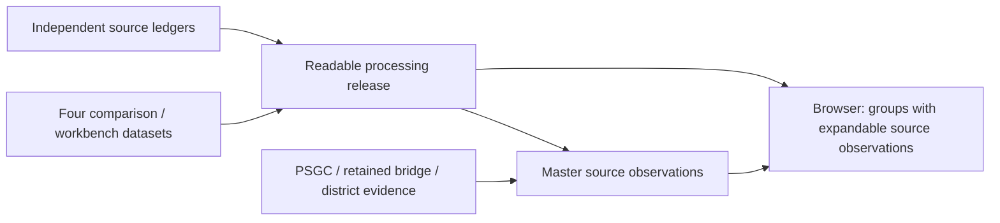

# Readable processing dataset

This is a pre-generated consumer layer over the four existing workbench JSONs.
It adds readable titles and materializes their comparison partitions without
rerunning project matching or rewriting the upstream files. The master-list
builder now consumes this release, adds location observations, and preserves
its comparison links. The browser joins those observations to these same
comparison groups.



The extra master-list layer records provisional findings for each source
observation: `location`, its score/factors/review flags, coordinate summaries,
and legislative-district derivations. It does not change the upstream matches,
merge amounts between readings, or propagate a location from one group member
to another. Source IDs stay compatible with existing bridge consumers.

This document covers the data contract and browser wiring. The
[location roadmap](LOCATION_CONFIDENCE_AND_ROADMAP.md) explains the evidence
methodology, current corpus and migration results;
[SCORING_RULES.md](SCORING_RULES.md) specifies the factors and weights. The
location method remains `location_evidence_v6.5`, independently of this
release's `readable_title_v1` preprocessing method.

The [multidimensional assessment proposal](MULTIDIMENSIONAL_SCORING.md)
inventories which retained fields and separate derived layers can support
future evidence profiles. It keeps source-observation, comparison-stage,
counterpart-link and location-assertion assessments at their own grains.

The [location interpretation consumer](LOCATION_INTERPRETATIONS.md) now reads
master observations and processing-linked coordinate evidence to retain
alternative title/parent-chain candidates with separate context assessments.
It writes its own audited layer, including experimental
[candidate support scores and dry-run trial proposals](CONTEXT_SCORING.md).
Master scores, assignments, comparison membership and source amounts are
preserved by this consumer.

The separate [cleaned observation release](CLEANED_DATASET.md) now consumes
these layers, adopts eligible trial candidates provisionally and generates
conservative clarification questions against a shared catalog. It preserves
the processing values and comparison attachments and references full evidence
by record-local IDs. See the [review data contract](REVIEW_DATA_CONTRACT.md).
The browser exposes it under **Cleaned data**, while **Source data** retains
the existing master and applied-layer behavior. Both views use the same
observation identities and comparison membership.

## Coverage: matched, House-only and NEP-only

Yes: those three partitions cover the retained records **within each
comparison's scope**. House-only and NEP-only records are included in this
dataset. An unresolved House record with a fuzzy NEP suggestion remains
House-only; the suggested NEP row is not consumed and stays separately counted.

The current comparison scopes produce:

| Domain | Matched groups | House only | NEP only | Total groups |
|---|---:|---:|---:|---:|
| DPWH | 10,079 | 6,193 | 1,341 | 17,613 |
| FMR | 609 | 355 | 95 | 1,059 |
| HFEP | 341 | 172 | 123 | 636 |
| NIA | 606 | 222 | 185 | 1,013 |
| Total | 11,635 | 6,942 | 1,744 | 20,321 |

These groups cover **59,601 source observations**, counting every stage and
every member of a repeated-key group. Matched means attached by the upstream
comparison; the existing match method, scope-review status and ambiguity are
retained. It is not certification of one unique physical project.

The other **5,044 observations** are a different scope, not omitted House-only
comparison rows. They are **2,522 DPWH House GAS/S2O MOOE/CO allocation leaves
per reading**, consisting of 57 General Administrative and Support leaves and
2,465 Support to Operations leaves. The DPWH comparison's NEP project ledger
covers operations, so it never performed counterpart matching for these
administrative/support allocations. Labeling them unmatched would imply a
comparison that did not happen. They are retained as `not_compared` with their
section and scope reason.

All **64,645 observations** in the existing master-list scope are therefore
accounted for: comparison members plus outside-scope observations. This does
not expand coverage to every agency budget, personnel-services record, or
other record grain in the repository. Comparing additional NEP/House budget
sections would require explicit compatible source ledgers and matching rules.

## Inputs and output files

Primary comparison inputs:

- `analysis/data/comparison_projects_2027.json`
- `other-analysis/data/fmr_workbench.json`
- `other-analysis/data/hfep_workbench.json`
- `analysis-nia/data/nia_workbench.json`

The builder reuses `build_master_list.py::observations()` to enumerate the ten
independent extraction ledgers, preserve their source IDs/provenance, and
check membership and amounts. It also reads their retained FMR coordinate
layers and the HFEP discrepancy audit. It does **not** read the generated
master JSONL, bridge matches, PSGC location results, or stale GPS inventory.
This makes the new observation output independent of the master/bridge
feedback loop. The master enrichment still reads the retained bridge outputs;
this migration does not rebuild or remove that existing evidence dependency.

Outputs under [data/processing](../data/processing):

| File | Contents |
|---|---|
| `observations.jsonl.gz` | All 64,645 source observations, readable titles, source amounts/provenance, and comparison-group references. A single-member stage also retains its enriched `analysis_record` |
| `comparison_groups.jsonl.gz` | 20,321 existing comparison groups with hydrated, enriched stage records, readable titles, member observation IDs, and upstream status/method/suggestion metadata |
| `outside_comparison.jsonl.gz` | The 5,044 `not_compared` observations, also present in the full observation file. This is a subset, not additional funding |
| `audit.json` | Input and builder hashes, output hashes, per-dataset coverage/amounts, partitions, title rules/examples and the preserved HFEP discrepancy |
| `REPORT.md` | Human-readable partition and coverage summary |

These are regenerated local products and are Git-ignored, like their four
primary workbench inputs. Gzip headers use fixed timestamps; identical input
bytes and builder code produce identical output bytes. `audit.json` pins the
actual files consumed; it is not a guarantee that every upstream producer's
entire transitive provenance chain is fresh.

## Readable titles

The source `title` field is preserved. Every observation and every nested
analysis record with a title also carries:

| Field | Meaning |
|---|---|
| `title_source` | Exact title supplied by that record's upstream layer, which may already include a reviewed source repair |
| `title_clean` | Readable text after the conservative cleanup below |
| `title_clean_method` | Versioned method identifier, currently `readable_title_v1` |
| `title_clean_rules` | Only the transformation names that changed this title, in application order |

The rules decode semicolon-terminated HTML entities, compose Unicode using
NFC, collapse whitespace including nonbreaking spaces, and join split
letter–`ñ`/`Ñ`–letter sequences. Examples: `Las Pi ñ as` → `Las Piñas`,
`Osme ñ a` → `Osmeña`, and `DASMARI Ñ AS` → `DASMARIÑAS`.

This is readability cleanup, not general OCR correction. Spelling guesses,
matching abbreviations, AI-monitoring wording equivalences, station numbers,
structure IDs, coordinate digits and superscript units are not rewritten.
`Para ñ ague` becomes `Parañague`, not an inferred `Parañaque`. Existing HFEP
`title_raw`, normalization notes and amount lineage remain available. A clean
title is not a claim that all of its words were checked against the PDF.

## Comparison groups and stages

Group IDs are namespaced by domain and retain the upstream comparison ID.
They identify a generated comparison record, not a stable physical-project
identity across arbitrary future source editions.

`stages` contains DPWH `api`, `nep`, `second`, `third`, or annex `nep` and
`house` records. Every present stage has `observation_ids`, integer
`amount_php`, readable-title fields, and its retained upstream details.
DPWH compact `inherit` fields are restored. FMR coordinates, segments, points,
normalization rules, image-review and PSGC evidence remain in their own stage.
DPWH chainage/matching/office annotations and HFEP funding columns/lineage are
retained. No new GPS or location inference is performed by this builder.

The group-level display title identifies its `title_source_stage`: prefer
third reading, second reading, annex House, NEP, then API. This display choice
does not replace titles or geometry on other stages. A repeated-key stage
keeps its member observations and aggregate amount; its shared annotations
are not copied onto each member as individual findings.

`partition` is `matched`, `house_only`, `nep_only`, or, if an upstream input
ever supplies one, `api_only`. DPWH's overall membership retains both House
readings; `presence_by_house_reading` additionally reports `both`,
`house_only`, `nep_only`, or `neither` for each individual reading. Consult
`upstream.house_match`, `upstream.reading_status`, and the other retained
upstream metadata for the actual identity/scope-review interpretation.
Missing amounts remain missing stages, rather than zero appropriations.

## Generate and verify

The webapp's `predev` and `prebuild` scripts generate this layer after the four
comparison inputs. With those inputs already generated, run independently:

```sh
python3 master_list/scripts/build_processing_dataset.py
python3 master_list/scripts/build_processing_dataset.py --check
python3 master_list/scripts/build_coordinate_psgc.py
python3 master_list/scripts/build_master_list.py
python3 master_list/scripts/build_applied_suggestions.py
python3 master_list/scripts/build_location_interpretations.py
python3 master_list/scripts/build_cleaned_dataset.py
python3 master_list/scripts/build_viewer.py
python3 -m unittest discover -s master_list/tests -p test_processing_dataset.py -v
```

`--out <directory>` builds a separate release. `--check` regenerates into a
temporary directory and compares all five artifacts without replacing them.
The builder rejects unknown/reused source IDs, duplicated group members,
stage/member amount differences, unexplained scope exclusions, and incomplete
annex partition accounting. It preserves the NEP HFEP ledger/control gap.

With the four workbench inputs already generated, the complete local chain is
also available as `npm run build:master-list --prefix analysis/web`. Run
`npm run prebuild --prefix analysis/web` first when those workbench inputs need
regeneration. The normal web `predev`/`prebuild` regenerates the processing
release; the separate master-list command rebuilds the heavier enrichment
and embedded browser data.

## Browser and downstream contract

`data/projects.jsonl.gz` remains one row per source observation, with the
same `record_id`, source title, amount and provenance. It now also retains
`title_clean*`, `comparison_group_id`, `comparison_stage` and, where applicable,
`analysis_record`. Location inference uses `title_clean` and records
`location_title_field = title_clean`; coordinate extraction uses the original
title to preserve its source fragments. Existing normalized FMR coordinates
remain preferred. These derived findings do not alter the processing release.

The master builder checks the processing audit, output hashes and direct
input/builder hashes. The viewer verifies that its group release is the exact
one pinned by the master audit, and rechecks member identities and stage sums.
Regenerate in processing → master → viewer order after upstream changes.

At `/master_list/` on the local Vite server, or by opening `index.html` directly:

- **Comparison groups** is the default: 20,321 groups, all allocations included.
  Expand a group to see every original source observation. Stage amounts stay
  separate; no overall multi-source budget total or group evidence score is
  asserted. Retained comparison/stage details include chainage, normalized
  coordinates, repair notes and upstream match/suggestion status.
- **All source observations** contains all 64,645 rows, including outside-scope
  allocations. Source/category/location-score/review filters operate on these
  individual observations. The same filters select comparison groups when at
  least one member satisfies every filter; expanded groups show all members
  and mark those that matched. Group amounts show complete stages even when a
  filter selects only some members; the filtered source total uses only the
  matching observations. Amount sorting requires one selected source; score
  sorting is available in observation views.
- **Outside comparison** contains the separate 5,044 House GAS/S2O observations.
  They remain `not_compared`, rather than being relabeled House-only.

The viewer CSV is still an observation ledger. Its `title` is readable, and
`title_source`, `title_clean_method`, group ID and stage preserve provenance.
The underlying master JSONL and `projects.csv.gz` retain the original `title`
and a separate `title_clean`. Browser observations in this release are generated
evidence; reviewer-entered notes or overrides would need a separate persisted
collection with observation/group IDs and author/source provenance.

Example reading a comparison group's clean titles and per-stage amounts:

```python
import gzip
import json

with gzip.open('master_list/data/processing/comparison_groups.jsonl.gz', 'rt') as stream:
    for line in stream:
        group = json.loads(line)
        print(group['id'], group['partition'], group['title_clean'])
        for stage, record in group['stages'].items():
            print(stage, record['title_clean'], record['amount_php'])
        break
```
