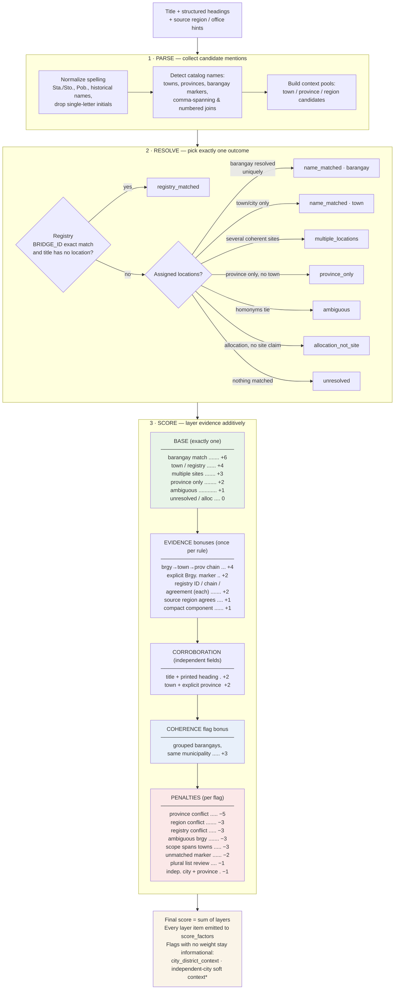

# Location scoring rules

**Method:** `location_evidence_v6` · **Suggestion method:** `hierarchy_candidate_v3`  
**Canonical source:** `scripts/locations.py` (`SCORE_BASES`, `SCORE_BONUSES`,
`SCORE_FLAG_BONUSES`, `SCORE_PENALTIES`) · **Machine-readable copy:**
`data/audit.json` → `location_score_rules`

The location score is an **uncapped additive evidence ledger**. It is not a
probability, percentile, grade, or quality threshold; negative totals are
allowed. A score changes only when source evidence or a documented rule
changes. This document is the human-readable reference; the code constants
and `audit.json` rule tables are regenerated together on every build, and the
tables below must match them exactly.

## How the layers apply

Scores are computed bottom-up in one pass: a single resolution **base** is
chosen first, then **evidence bonuses** and **corroboration bonuses** are
added for independently observed cues, then **coherence bonuses** for flags
that record internally consistent structure, and finally **penalties** for
contradictions and unresolved mentions. Every applied item is recorded in
`score_factors` as `base:` / `evidence:` / `corroboration:` / `coherence:` /
`penalty:` rules.

\* `independent_city_with_separate_province_context` keeps its −1 penalty; the
asterisk marks that it is a *soft* context the parser accepts (the location is
kept) rather than a rejection.

## Layer 1 — Resolution base (exactly one)

| Outcome | Rule id | Points |
|---|---|---:|
| One barangay resolved | `name_matched_barangay` | +6 |
| One municipality/city/sub-municipality | `name_matched_town` | +4 |
| Registry chain adopted (title had no location) | `registry_matched` | +4 |
| Several assigned locations | `multiple_locations` | +3 |
| Province only (no town matched) | `province_only` | +2 |
| Ambiguous candidates remain | `ambiguous` | +1 |
| Allocation, no site assertion | `allocation_not_site` | 0 |
| Unresolved | `unresolved` | 0 |

## Layer 2 — Evidence bonuses (each counted once per record)

| Cue | Rule id | Points |
|---|---|---:|
| Complete unmarked `barangay, town, province` suffix | `comma_barangay_municipality_province_chain` | +4 |
| Adjacent explicit `Brgy.`/`Barangay` marker | `explicit_barangay_marker` | +2 |
| Exact inventory `BRIDGE_ID` in title | `bridge_registry_id_match` | +2 |
| Matched bridge resolves to one PSGC chain | `bridge_registry_unique_chain` | +2 |
| Title scope intersects registry chain | `bridge_registry_agreement` | +2 |
| Source region agrees with assignment | `source_region_agreement` | +1 |
| Compact multi-level component fully covered | `compact_locality_component` | +1 |

Repeating the same barangay name in a title is one cue, not several.

## Layer 3 — Corroboration bonuses

| Independent agreement | Rule id | Points |
|---|---|---:|
| Accepted title name **and** printed source heading support the selection (or a parent) | `title_and_source_heading` | +2 |
| Selected town/barangay **and** its explicitly stated province form the stated chain | `explicit_parent_chain` | +2 |

A heading alone never earns corroboration; both independent fields must agree.

## Layer 4 — Coherence bonus

| Structural finding | Rule id | Points |
|---|---|---:|
| Several barangays named in one part all share one municipality (v6) | `grouped_barangays_under_same_municipality` | +3 |

## Layer 5 — Penalties

| Review condition | Rule id | Points |
|---|---|---:|
| Title/heading conflicts with stated province | `title_or_heading_province_conflict` | −5 |
| Source region conflicts with assigned region | `source_region_differs_from_title_location` | −3 |
| Registry chain disjoint from title assignment | `bridge_registry_conflicts_with_title_location` | −3 |
| Barangay name stays ambiguous after scoping | `ambiguous_barangay_name` | −3 |
| Barangay scope spans several municipalities | `barangay_scope_spans_multiple_municipalities` | −3 |
| Barangay marker cannot resolve under its context | `barangay_mentioned_but_unmatched` | −2 |
| Plural `Barangays` list needs review | `barangay_list_requires_review` | −1 |
| Independent city named beside a separate province (soft, kept) | `independent_city_with_separate_province_context` | −1 |

**Informational flags (no weight):** `city_district_context` — a conflicting
town mention explained as a city district (Jaro/La Paz in Iloilo City) is
recorded, not punished.

## Interpretation guardrails

- The score is **evidence quantity, not confidence**. A corridor project
  legitimately naming five towns outscores a single clean barangay mention;
  that is more evidence, not more certainty.
- Penalties never delete an assignment by themselves; they mark review. A
  hard `title_or_heading_province_conflict` clears the accepted set during
  resolution (becoming `ambiguous`), but scoring only *reflects* that outcome.
- Registry evidence never overrides a title-asserted location: agreements
  score, disagreements flag (−3), and only fully unresolved titles adopt the
  registry chain as `registry_matched`.
- `needs_review` is any status other than `name_matched` or any flag present.

## Worked examples

| Title (abbreviated) | Layers applied | Score |
|---|---|---:|
| `... Brgy. Langatian, Pres. Manuel, Roxas, Zamboanga del Norte` | base barangay +6, marker +2, parent chain +2 | **10** |
| `... Barangay Camanggaan- ... - Barangay Cacabugaoan, San Nicolas, Pangasinan` (5 of 8 brgys resolve, grouped) | base multiple +3, marker +2, parent chain +2, grouped +3 | **10** |
| `... Barangay 1, San Lorenzo, Laoag City, Ilocos Norte` (numbered comma join) | base barangay +6, marker +2, parent chain +2 | **10** |
| `... Barangay Javellana, Jaro, Iloilo City, Iloilo` (district context) | base multiple +3, marker +2, parent chain +2, soft-city −1 | **6** |
| `... Brgy. Wangke, Claver Surigao del Norte` | base barangay +6, marker +2, compact +1, parent chain +2, region +1 | **12** |
| Registry: exact `BRIDGE_ID`, title had no location | base registry +4, ID +2, chain +2 | **8** |
| `allocation for Region-wide ...` (no site claim) | base allocation 0 | **0** |

## Change control

Every scoring revision receives a new method identifier, an audit entry, and
a changelog section in
[LOCATION_CONFIDENCE_AND_ROADMAP.md](LOCATION_CONFIDENCE_AND_ROADMAP.md).
Rule tables in this document, the code constants, and `audit.json` are
updated together in the same commit; a mismatch between them is a defect.
