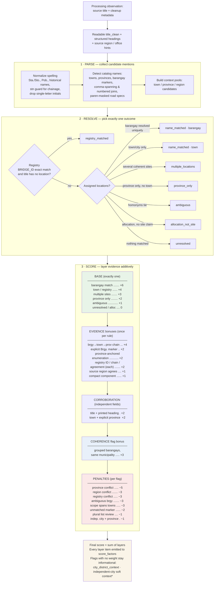

# Location scoring rules

**Method:** `location_evidence_v6.5` · **Suggestion method:** `hierarchy_candidate_v6`
**Canonical source:** `scripts/locations.py` (`SCORE_BASES`, `SCORE_BONUSES`,
`SCORE_FLAG_BONUSES`, `SCORE_PENALTIES`) · **Machine-readable copy:**
`data/audit.json` → `location_score_rules`

The location score is an **uncapped additive evidence ledger**. It is not a
probability, percentile, grade, or quality threshold; negative totals are
allowed. A score changes only when source evidence or a documented rule
changes. This document is the human-readable reference; the code constants
and `audit.json` rule tables are regenerated together on every build, and the
tables below must match them exactly.

The [multidimensional assessment proposal](MULTIDIMENSIONAL_SCORING.md)
inventories the available source, geographic, spatial, identity and accounting
context, including the applied-suggestion and coordinate-PSGC layers. It
proposes separate evidence profiles and task-specific assessments; the active
rules and weights below remain the current implementation.

[Location interpretations](LOCATION_INTERPRETATIONS.md) now provides a
separate implemented profile for candidate title readings and contextual
agreement/conflict, including candidates that the strict selected hierarchy
does not adopt. It keeps catalog parents intact and retains contradictions
without removing the candidate. Its method is `location_interpretations_v6`.
The separate [candidate support rules](CONTEXT_SCORING.md),
`context_evidence_v3`, add experimental text/spatial/context/registry scores
and trial checks. They do not replace the numeric `location_evidence_v6.5`
ledger described below. The browser labels these **Master score** and
**Candidate support**, respectively.

## Input and observation scope

Version 6.3 adds explicit numbered-barangay matching against complete catalog
names (`Barangay 898`, including `Brgy.`/`No.` forms and catalogued suffixes).
Bare numbers and station values are not indexed as barangay names. City
scoping follows the full ancestry through submunicipalities, so Manila's
district level does not block a valid city match. The point weights below
are unchanged; the parser revision is recorded in the
[v6.3 work log](LOCATION_CONFIDENCE_AND_ROADMAP.md#what-changed-in-v63-numbered-barangays-and-manila-ancestry).

The master builder consumes the validated
[readable processing release](PROCESSING_DATASET.md), then adds location
evidence to each source observation. Its location matcher reads `title_clean`
alongside structured locality headings and source context; the record stores
`location_title_field = title_clean`. Original `title`/`title_source` and the
applied `title_clean_rules` remain available for audit.

Readable cleanup is versioned as `readable_title_v1`. Joining split `ñ`,
composing Unicode and repairing whitespace/entities can change which catalog
names the parser recognizes without changing these scoring weights. Cleanup
adds no points by itself. The current score method remains
`location_evidence_v6.5`; the
[roadmap migration entry](LOCATION_CONFIDENCE_AND_ROADMAP.md#processing-release-migration-2026-10-26)
records the resulting code/status/score changes.

`location.score`, `location.score_factors`, `location.status` and
`location.needs_review` belong to an individual source observation. Comparison
match methods, similarity values and membership are separate upstream findings.
The browser expands a group into its observations without combining their
scores or assigning one member's location to the others. Stage amounts also
remain separate.

The [v6.4 revision](LOCATION_CONFIDENCE_AND_ROADMAP.md#what-changed-in-v64-missing-commas-and-connected-review-suggestions)
reuses complete catalog-validated compact components in ordered parent-chain
matching. Missing commas do not require editing source titles. The same
reader supplies unmarked parent-chain review candidates, including conflicting
printed provinces. Their suggestion factor is +2 for an unmarked chain,
versus +4 for an explicit barangay mention; the main score tables are unchanged.
Unmarked hypotheses carry `review_only: true` and cannot be auto-applied.
The browser joins interpretation dimensions into the hierarchy-review cards;
context-only cards have no numeric title support or combined confidence score.

The [v6.5 revision](LOCATION_CONFIDENCE_AND_ROADMAP.md#what-changed-in-v65-province-supported-barangay-reviews-and-record-inspection)
also permits explicit barangay review candidates scoped by printed province
or office province when no named-parent candidate fits. Their support includes
only available factors: no parent-town factor is invented. They remain
`review_only` regardless of numeric support. Station suffixes stop masking
locality components while original titles and retained chainage stay intact.
The main evidence weights below remain unchanged.

## How the layers apply

The final scoring pass follows title/heading resolution, source-region checks
and the retained bridge-registry join. A single resolution **base** is
chosen first, then **evidence bonuses** and **corroboration bonuses** are
added for independently observed cues, then **coherence bonuses** for flags
that record internally consistent structure, and finally **penalties** for
contradictions and unresolved mentions. Every applied item is recorded in
`score_factors` as `base:` / `evidence:` / `corroboration:` / `coherence:` /
`penalty:` rules.

\* `independent_city_with_separate_province_context` keeps its −1 penalty; the
asterisk marks that it is a *soft* context the parser accepts (the location is
kept) rather than a rejection.

## Layer 1 — Resolution base (exactly one)

| Outcome | Rule id | Points |
|---|---|---:|
| One barangay resolved | `name_matched_barangay` | +6 |
| One municipality/city/sub-municipality | `name_matched_town` | +4 |
| Registry chain adopted (title had no location) | `registry_matched` | +4 |
| Several assigned locations | `multiple_locations` | +3 |
| Province only (no town matched) | `province_only` | +2 |
| Ambiguous candidates remain | `ambiguous` | +1 |
| Allocation, no site assertion | `allocation_not_site` | 0 |
| Unresolved | `unresolved` | 0 |

## Layer 2 — Evidence bonuses (each counted once per record)

| Cue | Rule id | Points |
|---|---|---:|
| Complete unmarked `barangay, town, province` suffix | `comma_barangay_municipality_province_chain` | +4 |
| Province-anchored enumeration fully segmented into anchor-town barangays | `province_anchored_enumeration` | +2 |
| Adjacent explicit `Brgy.`/`Barangay` marker | `explicit_barangay_marker` | +2 |
| Exact inventory `BRIDGE_ID` in title | `bridge_registry_id_match` | +2 |
| Matched bridge resolves to one PSGC chain | `bridge_registry_unique_chain` | +2 |
| Title scope intersects registry chain | `bridge_registry_agreement` | +2 |
| Source region agrees with assignment | `source_region_agreement` | +1 |
| Compact multi-level component fully covered | `compact_locality_component` | +1 |

Repeating the same barangay name in a title is one cue, not several. An
enumeration of *different* members is one `province_anchored_enumeration`
cue covering the whole run. A mention inside balanced parentheses (road
specifications, bridge IDs) stays a candidate but never counts as an
assertion.

## Layer 3 — Corroboration bonuses

| Independent agreement | Rule id | Points |
|---|---|---:|
| Accepted title name **and** printed source heading support the selection (or a parent) | `title_and_source_heading` | +2 |
| Selected town/barangay **and** its explicitly stated province form the stated chain | `explicit_parent_chain` | +2 |

A heading alone never earns corroboration; both independent fields must agree.

## Layer 4 — Coherence bonus

| Structural finding | Rule id | Points |
|---|---|---:|
| Several barangays named in one part all share one municipality (v6) | `grouped_barangays_under_same_municipality` | +3 |

## Layer 5 — Penalties

| Review condition | Rule id | Points |
|---|---|---:|
| Title/heading conflicts with stated province | `title_or_heading_province_conflict` | −5 |
| Source region conflicts with assigned region | `source_region_differs_from_title_location` | −3 |
| Registry chain disjoint from title assignment | `bridge_registry_conflicts_with_title_location` | −3 |
| Barangay name stays ambiguous after scoping | `ambiguous_barangay_name` | −3 |
| Barangay scope spans several municipalities | `barangay_scope_spans_multiple_municipalities` | −3 |
| Barangay marker cannot resolve under its context | `barangay_mentioned_but_unmatched` | −2 |
| Plural `Barangays` list needs review | `barangay_list_requires_review` | −1 |
| Independent city named beside a separate province (soft, kept) | `independent_city_with_separate_province_context` | −1 |

**Informational flags (no weight):** `city_district_context` — a conflicting
town mention explained as a city district (Jaro/La Paz in Iloilo City) is
recorded, not punished.

## Interpretation guardrails

- The score is **evidence quantity, not confidence**. A corridor project
  legitimately naming five towns outscores a single clean barangay mention;
  that is more evidence, not more certainty.
- Penalties never delete an assignment by themselves; they mark review. A
  hard `title_or_heading_province_conflict` clears the accepted set during
  resolution (becoming `ambiguous`), but scoring only *reflects* that outcome.
- Registry evidence never overrides a title-asserted location: agreements
  score, disagreements flag (−3), and only fully unresolved titles adopt the
  registry chain as `registry_matched`.
- The name parser sets `needs_review` when its status differs from
  `name_matched` or it has review flags. The master enrichment has explicit
  exceptions: allocations have `allocation_not_site`, score 0 and
  `needs_review = false`; adopting a unique registry chain sets
  `registry_matched` and `needs_review = false`. Source-region or registry
  conflicts can trigger review. Read the stored field alongside status and
  factors; `false` does not establish human verification.
- Parsed title coordinates and normalized FMR coordinate pairs are retained
  without adding score factors. The documented bridge-registry factors use
  retained registry/spatial evidence. Legislative-district lookups are unscored.
- `not_compared` is a comparison-scope classification. `allocation_not_site`
  is a location outcome. Outside-scope GAS/S2O allocations have both properties,
  while some operations-scope allocations belong to comparison groups.

## Worked examples

| Title (abbreviated) | Layers applied | Score |
|---|---|---:|
| `... Brgy. Langatian, Pres. Manuel, Roxas, Zamboanga del Norte` | base barangay +6, marker +2, parent chain +2 | **10** |
| `... Barangay Camanggaan- ... - Barangay Cacabugaoan, San Nicolas, Pangasinan` (5 of 8 brgys resolve, grouped) | base multiple +3, marker +2, parent chain +2, grouped +3 | **10** |
| `... Barangay 1, San Lorenzo, Laoag City, Ilocos Norte` (numbered comma join) | base barangay +6, marker +2, parent chain +2 | **10** |
| `... Barangay Javellana, Jaro, Iloilo City, Iloilo` (district context) | base multiple +3, marker +2, parent chain +2, soft-city −1 | **6** |
| `... Brgy. Wangke, Claver Surigao del Norte` | base barangay +6, marker +2, compact +1, parent chain +2, region +1 | **12** |
| `... s. Flores, Sinabaan, Cabalitian, ..., Barat and Esperanza, Umingan, Pangasinan` (10 members, all anchor-town barangays) | base multiple +3, enumeration +2, grouped +3, parent chain +2 | **10** |
| Registry: exact `BRIDGE_ID`, title had no location | base registry +4, ID +2, chain +2 | **8** |
| `allocation for Region-wide ...` (no site claim) | base allocation 0 | **0** |

## Change control

Every scoring revision receives a new method identifier, an audit entry, and
a changelog section in
[LOCATION_CONFIDENCE_AND_ROADMAP.md](LOCATION_CONFIDENCE_AND_ROADMAP.md).
Rule tables in this document, the code constants, and `audit.json` are
updated together in the same commit; a mismatch between them is a defect.

Readable preprocessing uses its own method identifier. When that input layer
changes, retain its original/clean titles and rules, rebuild processing →
master → viewer, and report location-result changes even if the location-rule
method stays the same. The [roadmap](LOCATION_CONFIDENCE_AND_ROADMAP.md) keeps
historical measurements separate from the current retained-build statistics.
